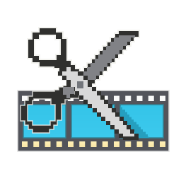
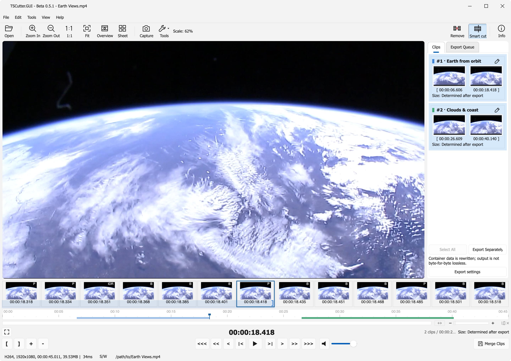
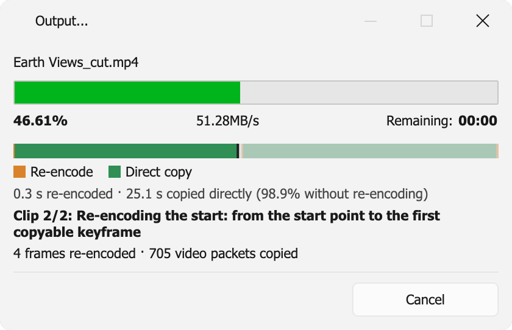
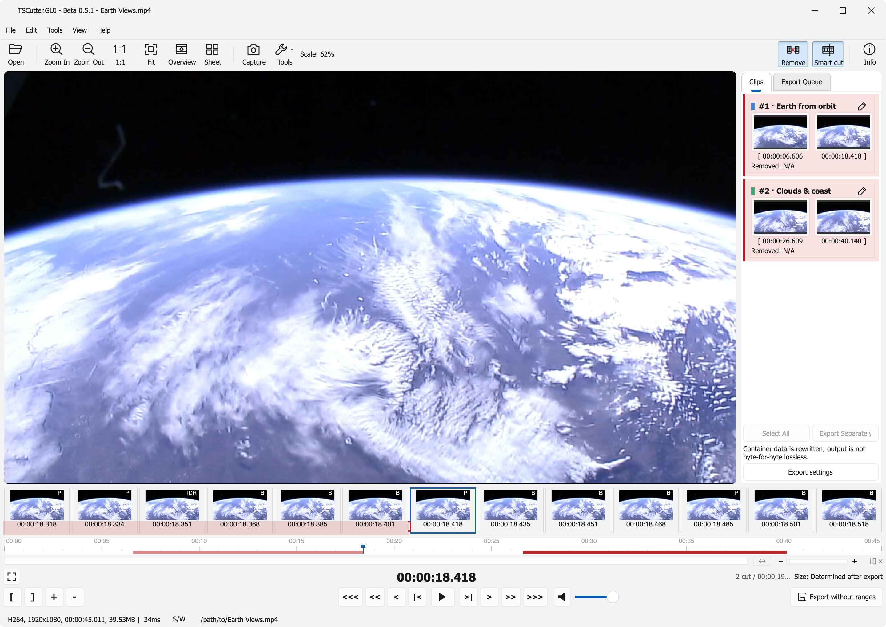

  
  <h1>TSCutter.GUI</h1>
  
<strong>English</strong> | <a href="README_CN.md">中文版</a>

  

    
  

TSCutter.GUI is a cross-platform video editor with fast keyframe cutting, frame-accurate smart cutting, media muxing, and MPEG-TS analysis and repair tools. Available for **Windows, macOS and Linux**.

**[Download the latest Beta](https://github.com/nilaoda/TSCutter.GUI/releases/latest)** · [User guide](docs/USAGE.md) · [Report an issue](https://github.com/nilaoda/TSCutter.GUI/issues)

<picture>
  <source media="(prefers-color-scheme: dark)" srcset="img/dark_en.png">
  
</picture>

## Video editing

| Mode | How it works |
| --- | --- |
| **Keyframe cutting** — default | Cut at compatible keyframes without re-encoding audio or video. |
| **Smart cut** | Choose any frame. Re-encode video near the cut points and copy the middle; audio and subtitles are not re-encoded. |

Turn on **Remove** to mark sections to discard, such as commercials or opening credits, then export the remaining video as one file. Remove mode works with either cutting mode; its end mark is the frame where playback resumes.

Save individual clips, merge selected ranges, or queue exports from multiple files. Keep clip names, notes and colors in a `.tscut` project and resume editing later.

  
See smart cut export progress and remove mode

  
Smart cut shows which parts are re-encoded and which are copied.

  <picture>
    <source media="(prefers-color-scheme: dark)" srcset="img/smart-cut_dark_en.png">
    
  </picture>

  
Remove mode marks discarded ranges in red across the timeline, frame strip and clip list.

  <picture>
    <source media="(prefers-color-scheme: dark)" srcset="img/remove_dark_en.png">
    
  </picture>

Keyframe-mode MP4/MKV exports rewrite the container and timestamps. Smart cut supports specific video formats, and re-encoded frames may differ slightly from the original. The app explains why smart cut is unavailable for a file. See [formats and limitations](docs/USAGE.md#smart-cut).

## Other features

- **Preview and navigate**: Audio playback, full screen, keyframe or frame thumbnails, a zoomable timeline, embedded subtitles and image search.
- **HDR preview**: SDR mapping for HDR10/PQ, HLG and Dolby Vision Profile 5, with GPU presentation and CPU fallback.
- **Media muxer**: Select and reorder tracks, edit languages and time offsets, convert text subtitles to suit the output format, and output MP4, MKV, TS or M2TS.
- **DVD and Blu-ray**: Open ISO images or disc folders, select titles and playlists, preview VOB/PGS subtitles, and export clips. Disc menus and protected Blu-ray are not supported.
- **Export summaries**: View export records and TS check results. Checks run as the output is written, without a second scan.
- **Capture and diagnostics**: Save frames and thumbnail sheets, inspect media information, or test playback performance.

### TS inspection and repair

| Tools | Purpose |
| --- | --- |
| **Quick Check** | Find continuity, TEI/PES, clock and timestamp problems; export reports. |
| **Packet Viewer** | Inspect packet fields alongside Hex data and navigate by PID, packet or offset. |
| **Stream Filter / Editor** | Select tracks or services, remap PIDs, and edit service metadata. |
| **Multi-source Repair** | Repair damaged regions using compatible recordings of the same feed. |
| **Timeline Repair** | Check clock and timestamp jumps and correct them where possible. |
| **ES Extractor / Raw Stream Cutter** | Extract elementary streams or original byte and packet ranges. |
| **Binary Merge** | Join segments in order and remove matching overlaps. |

Cut TS/M2TS, remux MP4/MOV and MKV/WebM, and preview other video formats supported by FFmpeg. Supported TS packet sizes vary by tool; see the [user guide](docs/USAGE.md#ts-tools-and-packet-layouts).

## Get started

1. Open a video or drag it into the window.
2. Navigate to the desired frames and mark a clip's start and end. Enable **Smart cut** for frame-level boundaries, or **Remove** to mark unwanted ranges.
3. Save a clip, merge selected clips, or export the video without the selected ranges.
4. Save a `.tscut` project to continue later.

Official packages include the required [FFmpeg runtime](https://github.com/nilaoda/FFmpegSharedLibraries); no separate FFmpeg installation is needed.

On macOS, if quarantine blocks the app, run `xattr -dr com.apple.quarantine TSCutter.GUI.app`.

## Appearance and documentation

Choose from Windows Classic, XP, 7, 8, 10 and 11 themes, with separate light and dark palettes. macOS also offers a native macOS appearance. The interface supports English, Simplified Chinese and Traditional Chinese.

- [User guide](docs/USAGE.md) — editing, playback, muxing and format limitations.
- [Theme gallery](docs/THEMES.md).
- [Tool design documents](docs/README.md) · [Building and source layout](src/README.md).

Screenshot footage: NASA, [Earth Views from the ISS – No Music](https://images.nasa.gov/details/NHQ_2020_1221_Earth%20Views). [Source and usage notes](img/SOURCES.md).

## Thanks and license

Inspired by [VidePub](https://sourceforge.net/projects/videpub/). Licensed under [GPL-3.0](LICENSE).
