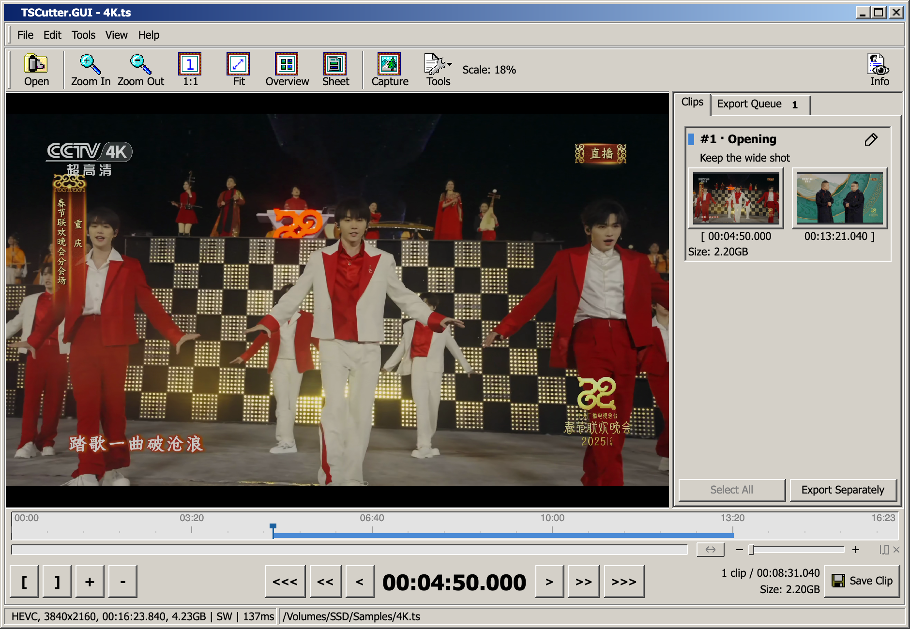

  
  <h1>TSCutter.GUI</h1>
  
<strong>English</strong> | <a href="README_CN.md">中文版</a>

TSCutter.GUI is a cross-platform MPEG-TS editing and diagnostic toolkit. It combines fast keyframe-based cutting with stream inspection, extraction, filtering, structural editing, repair, merging, and packet analysis tools, without transcoding the original audio or video.

> TSCutter.GUI is now in public **Beta**, starting with version **0.1.0**. Download the [latest release](https://github.com/nilaoda/TSCutter.GUI/releases/latest) and report problems through [GitHub Issues](https://github.com/nilaoda/TSCutter.GUI/issues). The software is still under development and may contain bugs.

## Features

### Editing workflow

- **Keyframe-accurate cutting**: Preview and navigate nearby keyframes or jump to a specific time before marking clip boundaries.
- **Zoomable timeline**: Continuously zoom, pan, or return to a full-file overview for accurate navigation in long recordings.
- **Multiple clip management**: Create and edit several clip ranges, view their positions on the timeline, and compare duration and estimated size.
- **Editing projects**: Save the current source, clip ranges, timeline view, and cross-file export queue in a `.tscut` file for later editing. Projects can reopen recordings that have grown since saving.
- **Program and video track selection**: Switch previews in files with multiple programs or video tracks. Keyframe overviews, thumbnail sheets, and frame searches follow the selected track. Multi-program TS exports can preserve all programs or keep only the current program. Ordinary files with one program and one video track show no selectors.
- **Flexible output**: Save one clip immediately, add clips to a batch export queue, or merge multiple selected clips into one TS file.
- **Lossless media copy**: Preserve the original encoded audio and video without transcoding.
- **Frame capture and media information**: Save or copy the current preview frame and inspect the opened file's stream information.
- **Image navigator**: Locate the visible region of a zoomed image with a floating overview in the main preview and thumbnail sheets. Click or drag to navigate; disable it in Settings.
- **High-resolution thumbnail sheets**: Generate configurable N×M contact sheets up to 12,000 pixels wide, preview them with zoom and pan, and export PNG or JPEG images with timestamps and labeled video, audio, and subtitle metadata, including language and HDR, HLG, or Dolby Vision indicators.
- **General video preview**: Open MP4, MKV, MOV, WebM, and other FFmpeg-supported video files for preview, seeking, screenshots, and media information. Non-TS files are preview-only.

### TS tools

- **TS Raw Stream Cutter**: Extract a byte or packet range directly from a TS file.
- **TS Quick Check**: Scan for synchronization loss, TEI/continuity/PES errors, PCR/PTS/DTS issues, A/V drift, bitrate changes, and export a text report.
- **TS Packet Viewer**: Inspect 188-byte TS or 192-byte M2TS packets, navigate by packet number, offset, or PID, and link parsed fields to highlighted Hex bytes. M2TS arrival headers and timestamps are also shown.
- **TS Elementary Stream Extractor**: Select one or more tracks and export their raw video, audio, subtitle, or data payload after removing TS and PES encapsulation.
- **TS Stream Filter**: Keep selected PIDs or split selected services while rebuilding the required program and service tables.
- **TS Stream Editor**: Remove tracks or services, remap identifiers and PIDs, and edit service or language metadata while preserving the original encoded media.
- **TS Timeline Repair**: Analyze and safely correct supported PCR and timestamp discontinuities without hiding transport or packet-loss errors.
- **TS Multi-source Repair**: Compare compatible recordings of the same feed and time period, then use healthy packet, PES, or elementary-stream data to repair damaged regions and long gaps where safe.
- **TS Binary Merge**: Append ordered TS segments, remove byte-identical overlaps, or merge overlapping recordings from the same source when only TS continuity counters differ.

Lossless clipping supports 188-byte TS and 192-byte M2TS based on the actual packet layout. M2TS defaults to `.m2ts` output and retains arrival headers. Quick checks (including batch checks), raw cutting, packet viewing, service splitting, and ES extraction also support M2TS. Timeline repair, stream filtering, stream editing, multi-source repair, and TS binary merge currently require 188-byte TS; unsupported packet sizes are reported explicitly.

### General

- **Multi-platform support**: Available for Windows, Linux, and macOS.
- **Multilingual interface**: English, Simplified Chinese, and Traditional Chinese.
- **Light and dark themes**: Theme-aware classic desktop interface.
- **Independent tool windows**: Open multiple tools or scans at the same time for comparison.
- **Bounded resource usage**: Large-file tools use streaming or on-demand reads instead of loading complete media files into memory.

## FFmpeg Runtime
Official release packages bundle the required **FFmpeg 9.0.2** shared libraries. End users do not need to install FFmpeg manually.

Bundled runtime source: [nilaoda/FFmpegSharedLibraries](https://github.com/nilaoda/FFmpegSharedLibraries).

> **macOS**: If the app is blocked by quarantine, run `xattr -dr com.apple.quarantine TSCutter.GUI.app`.

## Preview

<picture>
  <source media="(prefers-color-scheme: dark)" srcset="img/dark_en.png">
  <source media="(prefers-color-scheme: light)" srcset="img/light_en.png">
  
</picture>

## Usage

### Main editor

1. Launch the application.
2. Open a TS file or drag it into the main window.
3. Navigate or zoom the timeline, add a clip, and mark its start and end points.
4. Save the current clip, add it to the export queue, or select multiple clips and merge them.
5. Use the File menu to save a `.tscut` project and reopen it later to restore clips and queued exports. A growing source is accepted when verification of its saved portion succeeds.

Files with multiple programs or video tracks show selectors above the preview. After confirmation, switching tracks clears current clips and undo history; queued tasks retain their original program choice. “Export current program only” keeps all tracks in the selected program and applies to saving, merging, and newly queued tasks. New projects use version 2 and older projects remain readable; older app versions cannot open new projects.

### Independent TS tools

Open any utility directly from the **Tools** menu. Each tool opens in its own window and prompts for the required source file or files; no file needs to be loaded in the main editor first.

## Documentation

Design notes for the TS tools are available in [docs](docs/README.md).

## Thanks
This project is inspired by an excellent editing software called [VidePub](https://sourceforge.net/projects/videpub/).

## License
This project is licensed under the GPL-3.0 License.
