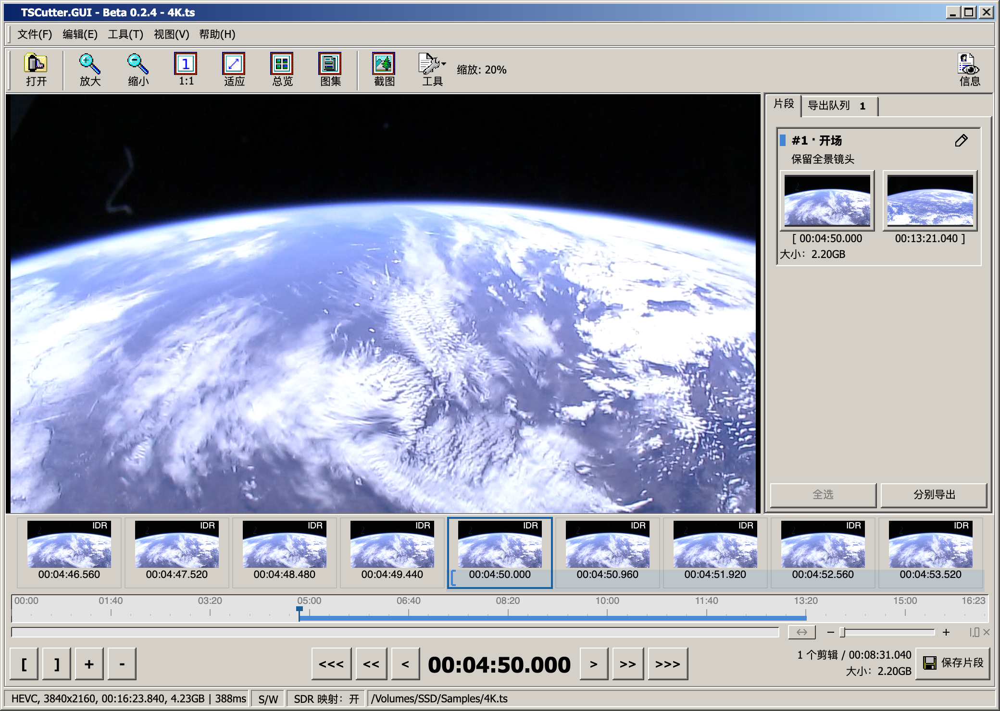
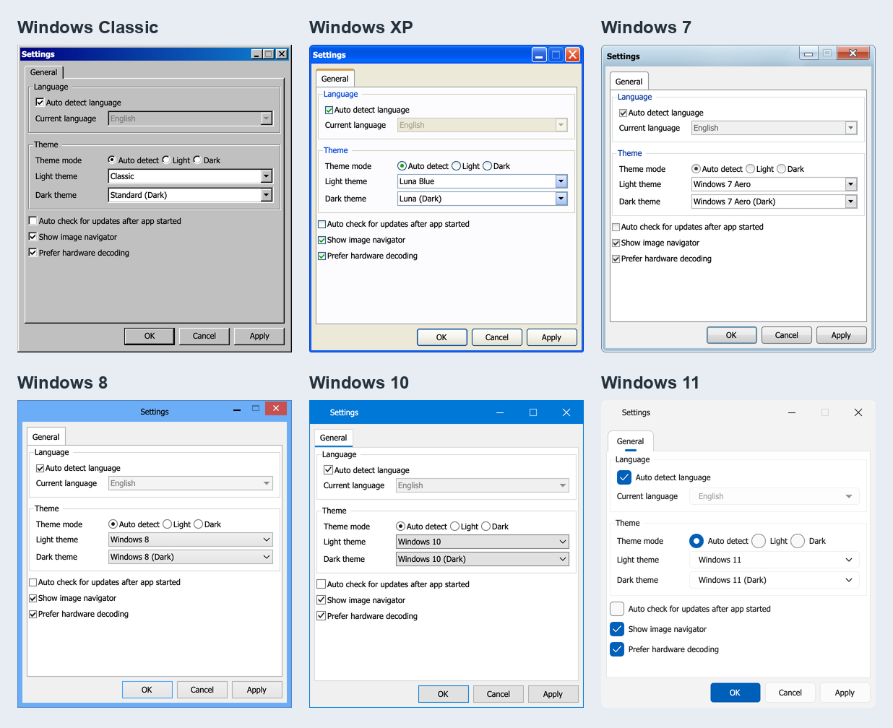

  
  <h1>TSCutter.GUI</h1>
  
<a href="README.md">English</a> | <strong>中文版</strong>

TSCutter.GUI 是一个跨平台的视频剪辑与 MPEG-TS 诊断工具。它支持 TS/M2TS 关键帧剪辑和 MP4/MKV 重封装导出，还提供流检查、提取、过滤、结构编辑、修复、合并和逐包分析能力，不重新编码原始音视频。

> TSCutter.GUI 已进入公开 **Beta 测试阶段**。请下载[最新版本](https://github.com/nilaoda/TSCutter.GUI/releases/latest)，并通过 [GitHub Issues](https://github.com/nilaoda/TSCutter.GUI/issues) 反馈问题。软件仍在开发中，可能存在缺陷。

## 功能

### 剪辑流程

- **关键帧级精确剪切**：预览和浏览相邻关键帧，或跳转到指定时间后标记剪辑边界。
- **关键帧总览与画面搜索**：浏览关键帧缩略图，管理已保存的画面模板，并在视频中搜索相似画面。
- **可缩放时间轴**：支持连续缩放、平移和快速返回总览，方便在长时间录制中精确定位。
- **多剪辑管理**：创建和编辑多个剪辑区间，在时间轴上查看位置，并比较时长和预计大小。
- **片段标注与命名**：为片段添加名称、备注和颜色，随工程及导出队列保存；可配置输出文件名模板并实时预览。
- **剪辑工程**：将当前素材、剪辑区间、时间轴视图和跨素材导出队列保存为 `.tscut` 文件，之后可继续编辑；仍在录制的 TS 文件新增内容后也可恢复工程。
- **节目与视频轨道选择**：多节目或多视频轨道素材可切换预览，关键帧总览、图集和画面搜索跟随当前轨道；多节目 TS 可选择保留全部节目或仅导出当前节目。包含内嵌字幕时也会显示选择区。
- **内嵌字幕预览**：选择 MP4、MKV、TS 中的文字或位图字幕，支持 ASS 样式、动画和 MKV 内嵌字体。字幕随实际显示帧刷新，并跟随画面缩放、平移；导出轨道仍由导出设置决定。
- **HDR 到 SDR 预览映射**：使用 CPU/SIMD 将 HDR10/PQ、HLG 和杜比视界 Profile 5 映射为 SDR。状态栏可临时切换映射和软硬解码，设置保存默认值；映射用于预览和截图，音视频导出不重新编码。
- **灵活输出**：可以立即保存单个剪辑、加入批量导出队列，或将多个选中剪辑合并为一个文件。
- **不转码导出**：直接复制原始音视频压缩包。
- **截图与媒体信息**：保存或复制当前预览帧，并查看已打开文件的流信息。
- **图像导航小地图**：主预览和图集预览放大后可通过悬浮缩略图查看当前位置，支持点击和拖动定位，可在设置中关闭。
- **高清缩略图图集**：按可配置的 N×M 网格生成最高 12000 像素宽的图集，支持缩放、拖动预览并导出 PNG 或 JPEG；可附带时间码及分类的视频、音频和字幕信息，包括语言以及 HDR、HLG 或杜比视界标识。
- **通用视频预览**：支持打开 MP4、MKV、MOV、WebM 及其他 FFmpeg 支持的视频格式进行预览、定位、截图和查看媒体信息。MP4/MOV、MKV/WebM 可导出为 MP4 或 MKV，其他非 TS 格式仅支持预览。

### MP4 / MKV 重封装剪辑与合并

- 在「MP4 / MKV 导出设置」中选择输出封装和保留轨道，保留源文件中的轨道顺序、语言、名称及默认/强制标记。
- 支持单片段、批量导出及同文件多片段合并；合并时选中片段的重叠区间仅保留一次。
- 视频按关键帧、音频按压缩包边界剪辑；兼容的文本字幕（包括 MP4 内嵌 mov_text 和 MKV ASS）与章节会裁剪并重设时间，MKV 可保留附件，MP4 可保留封面。
- 复制音视频压缩包和编解码配置，保留封装可承载的色彩、HDR 静态信息及杜比视界配置；码流中的动态元数据随压缩包保留。
- 自动检查编码和轨道兼容性；无法安全剪辑或合并时明确提示。

**MP4/MKV 导出不重新编码音视频，但并非字节级无损。** 容器结构、时间戳及元数据会重新写入，文件哈希和大小会变化；可保留的元数据字段取决于输出封装。MP4 保留封面时使用标准元数据字段，其他 MP4 输出可写入自定义元数据。MKV 字幕默认快速定位，回看每段起点前约 30 秒，可能遗漏更早开始且跨越起点的字幕；需要完整保留时可在导出设置中关闭。失败或取消时保留已有目标文件，并清理临时输出。

### TS 工具

- **TS 原始流截取**：按字节范围或包范围直接提取 TS 数据。
- **TS 快速检查**：扫描同步丢失、TEI、连续计数器、PES、PCR、PTS、DTS、音视频漂移和码率变化，并可导出文本报告。
- **TS 包查看器**：逐包查看 188 字节 TS 或 192 字节 M2TS 数据，按包编号、偏移或 PID 导航，并将解析字段与 Hex 字节高亮关联。M2TS 可查看附加头和到达时间戳。
- **TS ES 提取器**：选择一条或多条轨道，去除 TS 和 PES 封装后分别输出原始视频、音频、字幕或数据负载。
- **TS 流过滤器**：保留选定 PID，或按服务拆分文件，同时重建必要的节目表和业务表。
- **TS 流编辑器**：删除轨道或节目、调整标识及 PID，并编辑服务或语言信息，同时保留原始媒体编码。
- **TS 时间轴修复**：分析并安全校正受支持的 PCR 和时间戳不连续问题，不掩盖传输错误或真实丢包。
- **TS 多源修复**：比较同一信号源、同一时间段的兼容录制，在安全匹配的前提下使用正常的 TS 包、PES 或 ES 数据修复损坏区域及大段缺失。
- **TS 二进制合并**：按顺序追加 TS 分片、去除完全相同的二进制重叠，或合并仅连续计数器不同的同源重叠录制。

支持 188 字节 TS 和 192 字节 M2TS 无损剪辑，按实际包结构识别；M2TS 默认输出为 `.m2ts`，保留附加头。快速检查（含批量）、原始切割、包查看器、节目拆分和 ES 提取也支持 M2TS。时间轴修复、流过滤、流编辑器、多源修复和 TS 二进制合并暂仅支持 188 字节 TS；不支持的包长会明确提示。

### 通用能力

- **多平台支持**：支持 Windows、Linux 和 macOS。
- **多语言界面**：支持英文、简体中文和繁体中文。
- **桌面主题**：Windows Classic、XP、7、8、10、11 六个系列，可分别配置深浅配色并跟随系统切换；macOS 上另有使用系统原生标题栏的 macOS 外观。
- **独立工具窗口**：可同时打开多个工具或扫描窗口进行对照。
- **有界资源占用**：面向大文件的工具采用流式或按需读取，不会把完整媒体文件加载到内存。

## FFmpeg 运行时
官方发布包已内置 **FFmpeg 9.0.2** 共享库，普通用户无需手动安装。

内置运行时来源：[nilaoda/FFmpegSharedLibraries](https://github.com/nilaoda/FFmpegSharedLibraries)。

> **macOS**：若因隔离属性（quarantine）被拦截，请执行 `xattr -dr com.apple.quarantine TSCutter.GUI.app`。

## 界面预览

<picture>
  <source media="(prefers-color-scheme: dark)" srcset="img/dark_cn.png">
  <source media="(prefers-color-scheme: light)" srcset="img/light_cn.png">
  
</picture>

### 桌面主题

提供六个 Windows 风格的主题系列及各自的深浅配色，均可在 Windows、Linux 和 macOS 上使用。

macOS 上所有主题均提供系统菜单栏，Windows 系列主题同时保留窗口内菜单栏。

在 macOS 上还会额外提供 **macOS** 外观：窗口保留系统红黄绿、圆角和阴影，标题融入内容顶部，菜单使用屏幕顶部的系统菜单栏；控件沿用 Fluent 配色，只在 macOS 上出现在主题菜单中。

<a href="docs/THEMES_CN.md">
  <picture>
    <source media="(prefers-color-scheme: dark)" srcset="img/themes/overview-dark.png">
    
  </picture>
</a>

通过 **视图 → 主题** 快速切换系列；在 **工具 → 设置** 中分别选择浅色、深色配色，并可设为 **自动检测**，跟随系统外观。XP 提供 Luna 蓝色、银色和橄榄绿，Classic 另有多套经典配色。

[查看主题图册 →](docs/THEMES_CN.md)

## 使用方法

### 主剪辑界面

1. 启动应用程序。
2. 加载 TS、M2TS、MP4 或 MKV 文件，或直接拖入文件。
3. 浏览或缩放时间轴，添加剪辑并标记起点和终点。
4. 保存当前剪辑、加入导出队列，或选择多个剪辑进行合并。
5. 需要稍后继续时，从“文件”菜单保存工程；之后打开 `.tscut` 工程即可恢复剪辑和导出队列。仍在增长的源文件可继续使用；如果已保存部分的校验不通过，则会拒绝恢复。

多节目、多视频或包含字幕的文件会在预览上方显示选择区。字幕默认关闭，首次选择时在后台读取，可随时关闭或改选其他轨道。切换节目或视频轨道会在确认后清空当前剪辑与撤销历史，已加入导出队列的任务保留原节目和轨道选择。对于多节目 TS，“仅导出当前节目”保留所选节目的全部轨道，适用于保存、合并及新加入队列的任务。新增工程使用版本 4，可读取版本 1、2、3 的工程；旧版软件不能打开新工程。

### 预览选项

在 **工具 → 设置** 中配置新打开文件默认使用的 HDR 到 SDR 映射和硬解偏好；状态栏的切换仅临时影响当前文件。

- **SDR 映射**入口仅在识别出 HDR 画面时显示。打开关键帧总览、图集和画面搜索时，也会使用当前映射状态。
- **H/W / S/W** 显示当前解码模式。Windows/macOS 上，当前视频及设备支持硬解时可点击切换；硬解不可用或失败回退软解后禁用。
- 切换映射或解码器会保持当前显示帧和剪辑边界。

### 片段标注与输出命名

点击片段卡片上的**铅笔图标** 编辑名称、备注和颜色，支持撤销/重做。时间轴以对应颜色显示片段，悬停可查看名称和备注。加入导出队列时，会保存当时的标注和剪辑边界。

在 **工具 → 设置 → 导出** 中设置文件名模板，适用于单片段保存、逐段批量导出及新加入队列的片段。默认模板为 `{source}_({start}-{end})`；合并输出继续使用独立的文件名建议。

| 占位符 | 含义 |
| --- | --- |
| `{source}` | 不含扩展名的源文件名 |
| `{name}` | 片段名称；为空时按序号使用 `clip001` 等名称 |
| `{index}` | 当前片段在列表中的位置，补齐为三位数字 |
| `{start}`、`{end}` | 起止时间，如 `00.00.10.000`；未设终点时使用视频时长 |

例如 `{source}_{index}_{name}` 可生成 `Recording_001_Opening.ts`。程序自动添加所选的 TS/M2TS/MP4/MKV 扩展名并替换文件名中的非法字符；批量导出遇到重名或已有文件时追加 `_2`、`_3` 等后缀。模板只影响之后的导出建议，已入队的输出路径保持所选值。

### 独立 TS 工具

可以直接从“工具”菜单打开任意工具。每个工具都会在独立窗口中引导选择所需的一个或多个源文件，无需先在主剪辑界面加载文件。

## 设计文档

TS 工具的设计说明位于 [docs](docs/README.md)，源码目录与命名空间约定位于 [src/README_CN.md](src/README_CN.md)。

## 致谢
此项目灵感来自一个出色的DVB视频剪辑软件 [VidePub](https://sourceforge.net/projects/videpub/)。

## 许可证
本项目采用 GPL-3.0 许可证。
