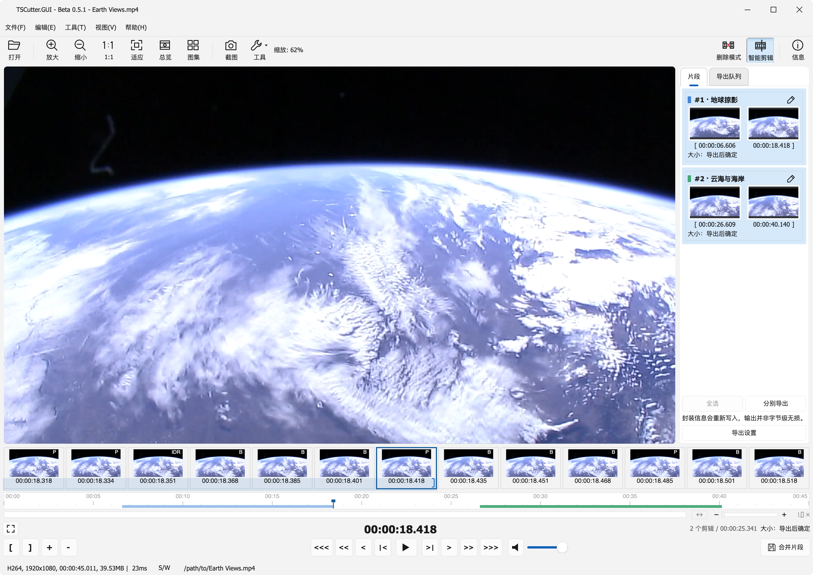
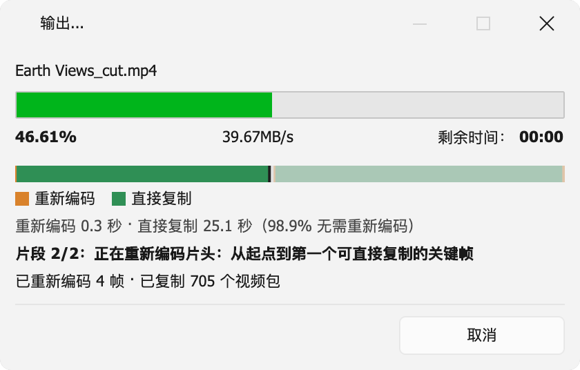
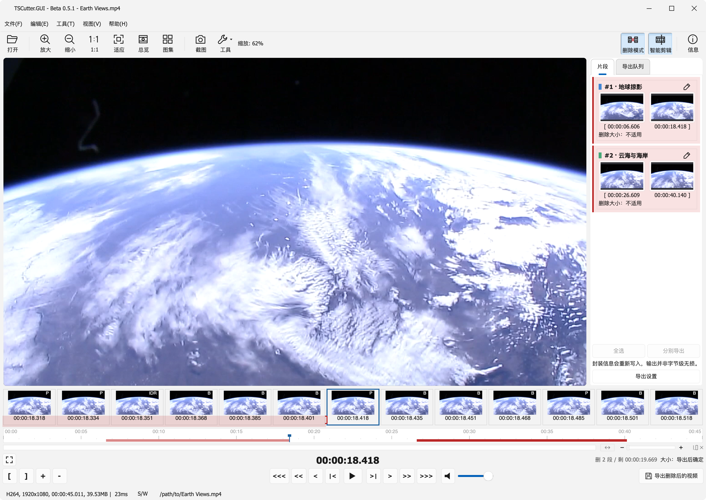

  
  <h1>TSCutter.GUI</h1>
  
<a href="README.md">English</a> | <strong>中文版</strong>

  

    
  

TSCutter.GUI 是一款跨平台视频剪辑工具，支持快速的关键帧剪切和精确到帧的智能剪辑，同时集成媒体混流、MPEG-TS 分析与修复功能。适用于 **Windows、macOS 和 Linux**。

**[下载最新 Beta 版](https://github.com/nilaoda/TSCutter.GUI/releases/latest)** · [使用指南](docs/USAGE_CN.md) · [反馈问题](https://github.com/nilaoda/TSCutter.GUI/issues)

<picture>
  <source media="(prefers-color-scheme: dark)" srcset="img/dark_cn.png">
  
</picture>

## 视频剪辑

| 模式 | 处理方式 |
| --- | --- |
| **关键帧剪辑**（默认） | 在兼容的关键帧处剪切，不重新编码音视频。 |
| **智能剪辑** | 按帧选择起止点，只重新编码切点附近的视频，中间部分直接复制；音频和字幕不重新编码。 |

开启 **删除**，即可把广告、片头片尾等标记为要去掉的范围，再将其余内容合并导出。删除模式可与两种剪辑方式搭配使用；终点标记表示恢复播放的那一帧。

可以保存单个片段、合并多个片段，或将不同文件的片段加入导出队列。保存为 `.tscut` 工程后，下次可继续编辑，片段名称、备注和颜色也会一并保留。

  
查看智能剪辑导出与删除模式

  
智能剪辑导出时，可查看重新编码与直接复制的分布及进度。

  <picture>
    <source media="(prefers-color-scheme: dark)" srcset="img/smart-cut_dark_cn.png">
    
  </picture>

  
删除范围以红色显示在时间轴、缩略图导航条和片段列表中。

  <picture>
    <source media="(prefers-color-scheme: dark)" srcset="img/remove_dark_cn.png">
    
  </picture>

关键帧模式导出 MP4/MKV 时会重写封装和时间戳。智能剪辑支持的编码格式有限，重新编码的画面与原片可能有细微差别；不支持时，界面会说明原因。详见[格式与限制](docs/USAGE_CN.md#智能剪辑)。

## 更多功能

- **预览与定位**：有声播放、全屏、关键帧或逐帧缩略图、可缩放时间轴、内嵌字幕和画面搜索。
- **HDR 预览**：支持 HDR10/PQ、HLG、杜比视界 Profile 5 到 SDR 的映射，播放时优先使用 GPU 处理画面，不支持时自动改用 CPU。
- **媒体混流**：选择轨道、调整顺序、修改语言与时间偏移，输出 MP4、MKV、TS 或 M2TS；文字字幕可按输出格式自动转换。
- **DVD 与蓝光**：打开 ISO 或光盘文件夹，选择标题与播放列表，预览 VOB/PGS 字幕，并导出片段；不支持光盘菜单和受保护蓝光。
- **导出摘要**：查看导出记录和 TS 检测结果，检测随导出进行，无需导出后重扫。
- **截图与诊断**：保存画面和缩略图图集、查看媒体信息，以及测试播放性能。

### TS 检查与修复

| 工具 | 用途 |
| --- | --- |
| **快速检查** | 检测连续计数器、TEI/PES、时钟与时间戳异常，并导出报告。 |
| **包查看器** | 对照解析字段与 Hex 数据，按 PID、包编号或偏移定位。 |
| **流过滤器／流编辑器** | 选择轨道或节目、调整 PID、编辑服务信息。 |
| **多源修复** | 对比同一信号源的多份录制，用完整的数据补回损坏或缺失的部分。 |
| **时间轴修复** | 分析时钟和时间戳跳变，修复可校正的异常。 |
| **ES 提取器／原始流截取** | 提取基本流，或截取原始字节与包范围。 |
| **二进制合并** | 按顺序合并分片，识别并去除重复的重叠部分。 |

支持 TS/M2TS 剪辑、MP4/MOV 和 MKV/WebM 的重封装导出，以及 FFmpeg 支持的通用视频预览。各 TS 工具支持的包长有所不同，详见[使用指南](docs/USAGE_CN.md#ts-工具与包结构)。

## 快速上手

1. 打开视频，或将文件拖入窗口。
2. 定位画面，标记片段起止点。需要按帧剪切时开启 **智能剪辑**；需要去掉片段时开启 **删除**。
3. 保存单个片段、合并选中片段，或导出删除所选范围后的内容。
4. 保存 `.tscut` 工程，之后继续编辑。

官方发布包已内置所需的 [FFmpeg 运行库](https://github.com/nilaoda/FFmpegSharedLibraries)，无需另行安装。

macOS 若因隔离属性被拦截，可执行 `xattr -dr com.apple.quarantine TSCutter.GUI.app`。

## 外观与文档

提供 Windows Classic、XP、7、8、10、11 主题，可分别设置深浅配色；macOS 还提供带原生标题栏的主题。界面支持英文、简体中文和繁体中文。

- [使用指南](docs/USAGE_CN.md)：剪辑、播放、混流及格式限制。
- [主题图集](docs/THEMES_CN.md)。
- [工具设计文档](docs/README.md) · [构建与源码结构](src/README_CN.md)。

截图画面来源：NASA，[国际空间站地球影像（无配乐）](https://images.nasa.gov/details/NHQ_2020_1221_Earth%20Views)。[素材来源与使用说明](img/SOURCES.md)。

## 致谢与许可

灵感来自 [VidePub](https://sourceforge.net/projects/videpub/)。本项目采用 [GPL-3.0](LICENSE) 许可证。
