# 主题图册

[English](THEMES.md) | [返回 README](../README_CN.md)

提供六个 Windows 主题系列，macOS 上另有 macOS 外观。Classic 展示一套浅色配色及 Standard (Dark) 深色配色。通过 **视图 → 主题** 快速切换系列，或在 **工具 → 设置** 中分别选择浅色、深色配色；**自动检测** 会跟随系统外观。

以下截图使用相同的设置窗口、尺寸和英文界面，点击可查看原图。Aero 与 Windows 11 展示实色回退外观，实际模糊或 Mica 材质取决于平台支持。深色配色包含本应用对经典 Windows 风格的扩展。

窗口圆角取决于宿主系统：Windows 11（Build 22000 及以上）上的 Aero 和 Windows 11 主题保留圆角，较旧 Windows 上这两个主题使用直角窗口。

在 macOS 上，所有主题都提供系统原生菜单栏；Windows 系列主题同时保留窗口内菜单栏，维持完整外观，macOS 外观在系统菜单可用时隐藏窗口内菜单。两处菜单共用命令、快捷键、多语言和勾选状态。

macOS 外观只在 macOS 上出现在主题列表中，保留系统红黄绿、窗口圆角和阴影，标题融入内容顶部，应用菜单移到系统菜单栏，并在可用时使用侧栏模糊材质；控件配色沿用 Windows 11 的 Fluent 风格，工具栏使用独立的单色矢量图标。在其他平台上该外观不出现在菜单中；共享配置中的 macOS 主题名称会被忽略。

## Windows Classic

| Classic | Standard (Dark) |
| :---: | :---: |
| <a href="../img/themes/classic.png">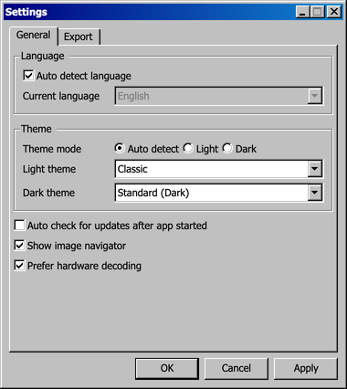</a> | <a href="../img/themes/dark-standard.png">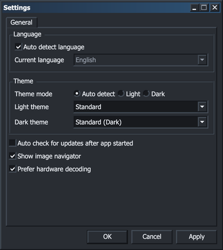</a> |

## Windows XP

| Luna Blue | Luna (Dark) |
| :---: | :---: |
| <a href="../img/themes/luna-blue.png">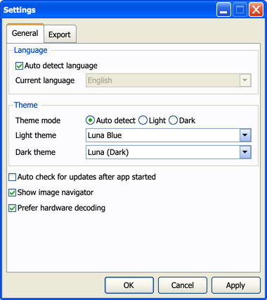</a> | <a href="../img/themes/luna-dark.png">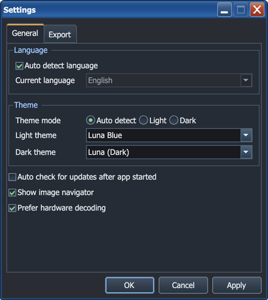</a> |

其他 Luna 配色：

| Luna Silver | Luna Olive Green |
| :---: | :---: |
| <a href="../img/themes/luna-silver.png">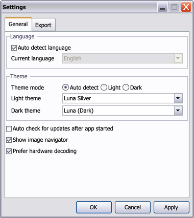</a> | <a href="../img/themes/luna-olive-green.png">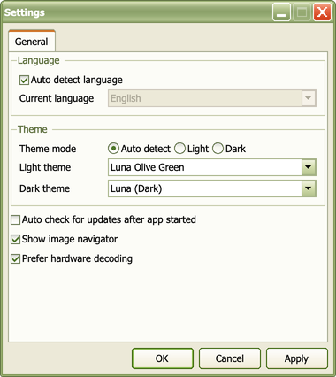</a> |

## Windows 7

| Windows 7 Aero | Windows 7 Aero (Dark) |
| :---: | :---: |
| <a href="../img/themes/aero.png">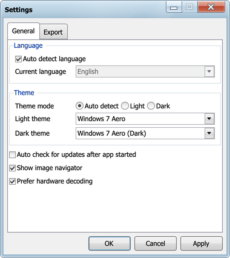</a> | <a href="../img/themes/aero-dark.png">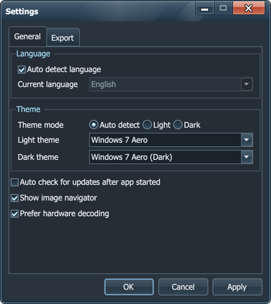</a> |

## Windows 8

| Windows 8 | Windows 8 (Dark) |
| :---: | :---: |
| <a href="../img/themes/windows8.png">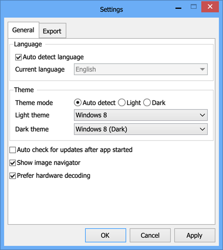</a> | <a href="../img/themes/windows8-dark.png">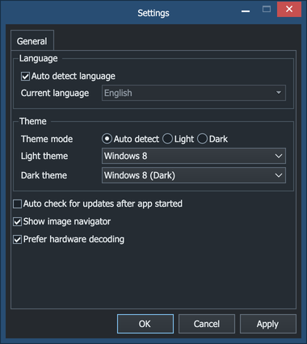</a> |

## Windows 10

| Windows 10 | Windows 10 (Dark) |
| :---: | :---: |
| <a href="../img/themes/windows10.png">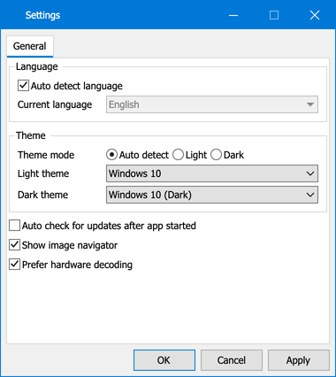</a> | <a href="../img/themes/windows10-dark.png">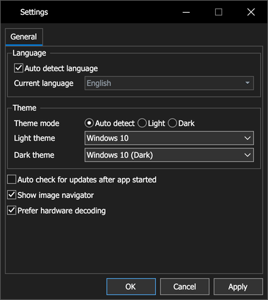</a> |

## Windows 11

| Windows 11 | Windows 11 (Dark) |
| :---: | :---: |
| <a href="../img/themes/windows11.png">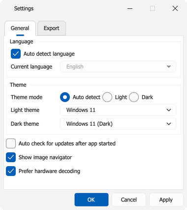</a> | <a href="../img/themes/windows11-dark.png">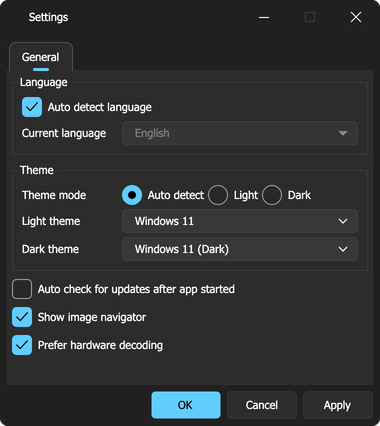</a> |
