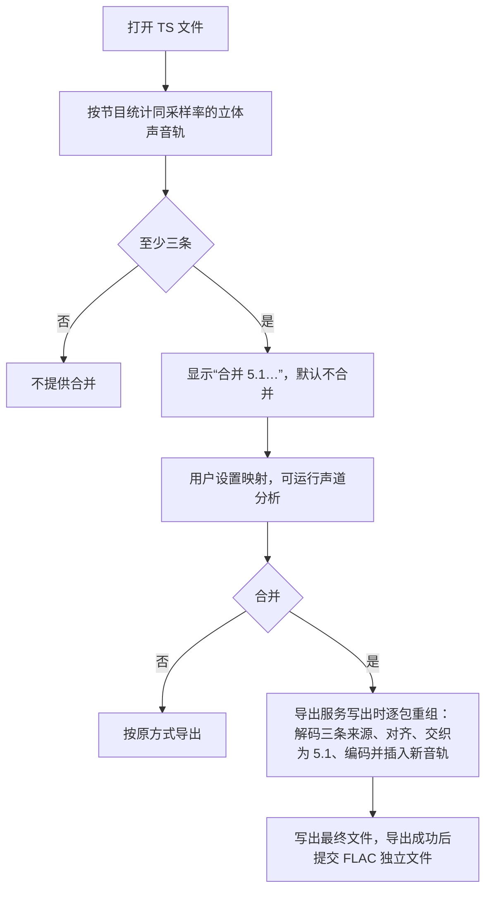

# 多轨合并为 5.1 设计方案

## 1. 目标

有些广播信号（例如体育赛事的公共信号）不用 AC3 或杜比 E 承载多声道，而是把一条离散 5.1 拆成三条立体声音轨：
第一条承载 L/R，第二条承载 C/LFE，第三条承载 Ls/Rs，相当于 SDI 嵌入音频的第 1–3 对。
逐条导出时得到三条互不相关的立体声，播放器通常只播放第一条，中置、低音和环绕都听不到。

本功能在导出时把这样的三条音轨合并为一条普通 5.1 音轨：

- 当前节目有三条以上采样率相同的立体声音轨时提供入口，由用户指定三个槽位各用哪条音轨、左右是否互换；
- 按需抽样分析各声道，给出建议的映射，或提示这些音轨不像拆分的 5.1；
- 合并结果可以编码为 AC3、E-AC3、AAC、FLAC 或 PCM，可以替换来源音轨，也可以同时保留；
- 与杜比 E 转码共用输出设置、编码和 TS 重组，不掩盖源文件原有的传输错误。

## 2. 范围与非目标

### 2.1 当前范围

- 188 字节 TS 与 192 字节 M2TS 的原包导出：关键帧剪切、只导出当前节目、逐包导出、合并、删除模式与智能剪辑；
- 来源编码：MPEG 音频（Layer I/II/III）、AAC（ADTS、LATM）、AC3、E-AC3，各为两声道、采样率相同；
- 每个节目一组合并，固定为 5.1（L R C LFE Ls Rs）。

### 2.2 非目标

- 不自动合并：码流中没有说明这种映射的信息，新打开的文件默认不合并；
- 不处理 MPEG-2 多声道扩展（stream_type 0x04 的扩展流或 MPEG-1 帧中的辅助数据）；
- 不做任意的逐声道矩阵，不支持 7.1 或四条以上音轨合并，不跨节目合并；
- 不处理 MP4、MKV 等其他封装的导出。

## 3. 承载方式与识别

PMT 中三条音轨通常只有 ISO 639 语言描述符，或者什么描述符都没有，没有任何字段说明它们是同一条 5.1 的不同声道。
因此打开文件时只做候选判断，不解码、不扫描：

- 节目中声道数为 2、采样率相同、属于上述编码的音轨至少三条时，该节目可以合并；
- 默认映射按 PID 顺序取前三条，正好对应常见的每两声道一对的顺序（L/R、C/LFE、Ls/Rs）；
- 是否真是拆分的 5.1、哪条在哪个槽位，由用户确认；分析结果只作参考。

在实际素材中，三条立体声并不都是 5.1：

| 情况 | 特征 | 分析结论 |
|---|---|---|
| 拆分承载的 5.1 | 有一路只有低频（LFE）；各声道彼此不同，没有一条是其他声道的下混；环绕电平较低、高频较少 | 给出建议映射 |
| 同一混音的多份副本 | 两条内容相同、左右声道相同（单声道），其余为静音占位 | 不像拆分的 5.1 |
| 校准阶段 | 所有声道都是同一个测试音 | 无法判断 |

## 4. 总体流程

## 5. 设置

每个节目记录一份设置：

- 处理方式：不合并，或合并为一条 5.1；
- 合并时是否同时保留来源音轨，默认不保留，合并结果替换它们；
- 三个槽位（前置、中置与低音、环绕）各自的来源 PID，以及左右是否互换；
- 输出列表：每行指定编码、声道（原始 5.1、立体声下混、单声道下混）、码率与语言。默认一行 AC3 448 kbps，语言取前置来源。

三个槽位必须是三条不同的音轨，否则不能确认。设置不写入程序配置，只随工程文件与导出队列保存；
重新打开同一文件（切换预览轨道）时保留，打开另一个文件时恢复为不合并。修改后，已导出的片段重新标记为待导出。

## 6. 声道分析

分析只在点击时运行，抽样方式与静音检测相同：全片均匀抽取 12 段，每段 1.5 秒，读取量与片长无关。

- 文件按字节位置均匀定位。拼接的文件中可能有很大的时间戳跳变，按时长定位会落在没有数据的位置；
  光盘按时间定位；
- 每段以定位后读到的第一个音频包为参照，各音轨按时间戳放进同一时间轴，统计每个声道的峰值、均方根、
  150 Hz 以上能量的占比（四阶高通）与峰均比，以及左右声道、音轨之间的相关系数；
- 判断：峰值低于 −60 dBFS 为静音；150 Hz 以上的能量比全部能量低 20 dB 以上为只有低频；峰均比低于 2 为测试音
  （正弦波约 1.41，节目声通常在 3 以上）；左右相关系数高于 0.999 为单声道；两条音轨的左声道相关系数高于 0.99、
  电平相差不到 2 dB 为内容相同。

结论只看所选的三条：

1. 有无法解码的音轨：无法推出映射；
2. 有测试音、其余都是测试音或静音：无法判断；
3. 有静音、单声道，或与另一条所选音轨内容相同：不像拆分的 5.1；
4. 恰有一条音轨的一侧只有低频：该音轨作中置与低音（LFE 在左时互换），其余两条中电平高、高频多的作前置，另一条作环绕；
5. 否则无法推出映射（LFE 可能整段静音）。

改变映射时用已有的统计重新得出结论，不必重新解码。

## 7. 试听

设置合并后，音频下拉末尾多一项“合并 5.1（下混试听）”，副标题列出三条来源。选中它时：

- 播放把三条来源的包都送进音频解码线程，分别解码后按与导出相同的规则（第 8 节）交织成 5.1，
  再由播放的重采样下混为立体声；时间以前置来源为准，定位后重新对齐；
- 导航条波形同样按合并结果绘制；
- 映射改变时试听项随之更新，正在试听时按新映射重新开始；取消合并时试听项去掉，改回第一条可以播放的音轨。

## 8. 解码与对齐

三条来源分别解码。PES 负载先切成完整的编码帧：MPEG 音频与 ADTS AAC 按帧头中的帧长自行切分，
其他编码用 FFmpeg 的解析器。FFmpeg 的 MPEG 音频解析器会丢掉第一帧，因此不用它。
PES 的 PTS 属于负载中开始的第一帧，同一 PES 中后续帧的时间按样本数推算。

解出的画面重采样为 48 kHz 浮点的左右两路（单声道复制到两路），按时间戳放进时间轴。前置来源是锚定来源：

- 合并结果的时间与分段以前置来源为准；它的帧与上一帧不衔接超过半帧时重新开始一段，与杜比 E 的规则相同；
- 前置来源的每一帧在其他来源的数据到齐后交织为 5.1。“到齐”指该来源最近一段解出的数据越过了这一帧的结束时刻，
  并且与它处在同一时间范围（时间戳跳变后，旧时间范围的数据不算）；
- 其他来源比前置来源晚开始、中途缺帧或时间戳跳变的部分补静音，早于前置来源的部分丢弃；
- 某个来源落后前置来源超过 2 秒（没有数据或长时间中断）时不再等它，相应时段补静音；
  已解码但还没合并的数据最多保留 30 秒。

## 9. 输出与 TS 重组

合并与杜比 E 转码共用一层音轨重建：

- 输出设置模型、码率选项与默认值、输出表格的界面；
- 输出链：重采样到 48 kHz、转换声道、编码 AC3/E-AC3/AAC，PCM 按 SMPTE 302M 打包，FLAC 另存为独立文件；
- 重组输出流：写入的字节逐包处理，PMT 改写、新音轨的放置、未选轨道的删除与杜比 E 转码完全相同（见杜比 E 转码设计方案第 10、11 节）。

一条重建音轨可以有多个来源 PID，第一个为锚定 PID，新音轨的包放在它的 PES 位置上。多轨合并的特别之处：

- 前置来源是锚定 PID；三个来源的包都参与解码，与写出顺序无关；
- 替换来源时，新音轨的包依次占用三个来源的包位置，多余的位置删去；载有 PCR 的来源包改为只含适配字段的包；
  第一路输出沿用前置来源的 PID（它兼作 PCR PID 时除外）；
- 新音轨在节目表中写在前置来源的位置之前，播放器默认选它；保留来源时来源条目留在其后；
- FLAC 独立文件命名为“输出文件名.51.flac”；同一导出中有多条重建音轨时再加上锚定 PID。

导出设置的轨道列表中：前置来源一行标注合并，取消勾选它就不合并；替换来源时其他来源标注“已并入”，不能单独勾选，
前置来源未选时它们也一并删去。导出记录与结果窗口用“合并 5.1”标签标注实际做过合并的输出。

独立 FLAC 文件没有时间戳，缺失的时段补静音、重叠的部分丢弃；两段之间相差超过 10 分钟时视为时间戳跳变，
接着写入，不补静音（杜比 E 转码也按这个规则处理）。

## 10. 已知限制

- 是否合并、怎样映射由用户决定；分析只抽样 12 段，LFE 在抽样处都静音时推不出映射；
- 只支持三条立体声合成 5.1；有损编码最多 5.1；
- 来源采样率不同时不提供合并；来源编码的有损损失不可逆，转为有损编码会再损失一代；
- 前置来源中断的时段，合并结果同样中断，不补静音；
- 试听按播放的默认下混规则输出立体声，LFE 不计入。

## 11. 验证方案

### 11.1 生成素材

测试素材生成脚本生成一份三条 MP2 的 TS：六个声道各是一个不同频率、带包络起伏和少量噪声的正弦，LFE 只有 50 Hz，
环绕音轨晚 80 ms 开始。

- 分析给出 0x101/0x102/0x103 的建议映射，0x102 右声道判为只有低频；
- 替换、保留与前置左右互换三种方式下，AC3 5.1 的六个声道各自以预期的频率为主；
  环绕声道开头 80 ms 为静音；新音轨在节目表中的位置与 PID 符合第 9 节；
- 批量复制任务经过重组流，导出结果标记“合并 5.1”；
- 试听：播放管线输出的立体声左声道含 L 与 Ls、右声道含 R 与 Rs，中置两边都有；波形按合并结果读出；
- 主窗口：设置合并后出现试听项与导出计划，工程保存后恢复；改回不合并时试听项去掉。

### 11.2 真实素材

- 体育公共信号（三条 MP2，第 4 秒附近有约 20 小时的时间戳跳变）：分析给出 L/R、C/LFE、Ls/Rs 的建议；
  合并结果的六个声道与 FFmpeg 命令行按同样映射合并的结果逐样本一致（FLAC），帧数与来源相同；
- 两路相同加两路静音的信号：判为不像拆分的 5.1；
- 校准阶段（全是 1 kHz 测试音）的信号：判为无法判断。

### 11.3 对杜比 E 转码的影响

杜比 E 转码改为使用共用的重建层后，用两份杜比 E 素材、三种设置（替换、保留、同时删去一条轨道）导出，
TS 与 FLAC 输出与改动前逐字节一致。

### 11.4 界面

- 设置窗口在三种界面语言下正常显示；默认不合并，切换为合并后默认一行 AC3 5.1；
- 分析结果、建议与采用建议、左右互换与重复槽位的提示正确；
- 设置随工程文件与导出队列保存和恢复。
