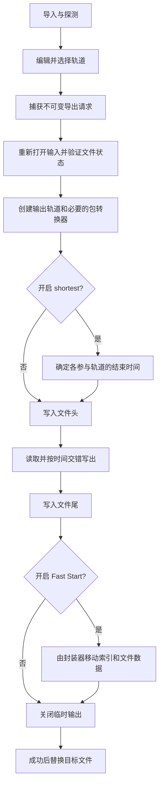

# 媒体混流工具实现说明

本文记录媒体混流工具的当前实现、格式兼容边界及实际遇到的问题，供维护和评审参考。示例中的 `video_a.ts`、`audio_b.m4a` 等均为通用占位名；回归素材由脚本合成，不随仓库保存真实视频。

## 1. 功能与默认行为

入口为 **工具 → 合并与混流 → 媒体混流**。

- 从多个文件选择音视频、字幕、封面或附件轨道，调整输出顺序。
- 编辑语言、轨道名称、默认／强制标记和毫秒级时间偏移。
- 输出 MP4、MKV、TS 或 M2TS；默认 MP4。
- 音视频复制压缩数据，不重新编码；不兼容的文字字幕可自动转换。
- **以最短轨道为准** 默认关闭；开启后可自行选择是否计入字幕。
- MP4 的 **为网络播放优化**（Fast Start）默认关闭。
- 当前最多 32 个输入、256 条轨道。封面与附件不参与时间偏移和 shortest 计算。

“音视频不重编码”不等于文件字节不变。容器、时间戳、元数据、NAL 起始码及包边界可能变化，源文件与输出文件的大小和哈希不要求一致。

## 2. 职责划分

| 处理层次 | 职责 |
| --- | --- |
| 媒体状态与请求快照 | 保存输入信息、选中轨道、顺序、属性、偏移及本次输出选项 |
| 输入探测与兼容性检查 | 识别轨道，判断目标格式能否直接复制，确定是否需要字幕转换 |
| 时间轴与截止判断 | 保留源内同步关系，应用偏移，计算最短轨道结束位置 |
| 包格式与字幕处理 | 转换 HEVC 包格式并保留解码参数，按需转换和裁剪文字字幕 |
| 交错写出与文件管理 | 控制读取顺序，写入容器，处理索引、临时文件、取消与目标替换 |
| 原生诊断与窗口交互 | 汇总错误，展示进度、兼容性说明及可编辑属性 |

界面只负责组织输出请求，封装过程直接调用 FFmpeg 运行库，不拼接或执行外部命令行。外部工具仅用于生成回归素材和独立验证。

## 3. 主流程与资源占用



每个源文件只保留一个输入上下文和一个待写包。同一文件的多个轨道共享游标，避免每条轨道单独打开并读取完整文件。服务按当前待写包经偏移后的 DTS 选择输入，FFmpeg 复用器负责进一步交错写出；每条输出轨道分别检查 DTS 单调性。

HEVC 转换额外持有一个当前包缓冲；字幕编码暂存区从共享池短时借用，完成编码后归还，交给复用器的字幕包按实际大小持有独立内存。两者均不缓存完整视频。`max_interleave_delta` 限制复用器等待稀疏轨道的交错时间。

普通混流没有事前全量扫描，也不在导出结束后重新读取输出做验证。shortest 缺失轨道时长时的读取，以及 Fast Start 的文件内数据搬移，是两个需要单独说明的例外，见后文。

## 4. 时间轴与偏移

### 4.1 以源时间轴为单位归零

同一源文件的音视频必须减去同一个时间原点，才能保留它们原有的同步关系。不能把每条轨道的首包分别归零。

基本关系为：

```text
输出时间 = 输入时间 - 源时间原点 + 用户偏移
```

源时间原点优先取容器起点，缺失时参考轨道起点。独立字幕保留其原来的提示时间：第一句在第 20 秒，不应因为它是首包就被搬到第 0 秒。

时间基转换使用整数运算及 `Int128` 中间结果，避免长文件和分数帧率在反复经过浮点换算后出现重复或倒退的 DTS。

Matroska 有时省略开始阶段的视频 DTS。此时依据已探测的重排序深度和帧间隔推导解码预滚，保留原 PTS；缺少可靠依据时给出错误。

### 4.2 负偏移的语义

偏移行为类似 FFmpeg `-itsoffset`：正数延后，负数提前。应用不为保留负时间内容而强制把所有轨道整体向后移动。

例如，5 秒视频与 6 秒音频均从零开始，音频偏移为 `-1000 ms`：

| 轨道 | 偏移后的时间范围 |
| --- | --- |
| 视频 | 0～5 秒 |
| 音频 | -1～5 秒 |

MP4 开启编辑列表后，可以跳过音频在零点前的内容，播放时长约为 5 秒。编辑列表控制播放范围，文件中仍可能保留不参与播放的音频预滚包；它不是对音频采样的重新编码裁剪。

输出上下文使用封装器默认的负时间戳处理规则。MKV、TS/M2TS 可能整体平移时间轴，因此不能承诺它们的文件起点和 MP4 一致。轨道之间的相对偏移仍应保持一致。

## 5. HEVC 转 MP4 的关键问题

### 5.1 FourCC 不能直接沿用源容器

TS 中的 HEVC 标记可能是传输流类型值，直接复制到 MP4 会造成写文件头失败。MKV 使用自己的 CodecID，也不应强行写入 MP4 的 FourCC。

当前统一规则为：

- 普通 HEVC 的 MP4 输出使用 `hvc1`。
- 有杜比配置侧数据，或输入带 `dvhe`／`dvh1` 标记时，MP4 输出使用 `dvh1`。
- 非 MP4 输出清除源 FourCC，由目标封装器写入原生标识。

所有 FourCC 使用命名常量。`dvhe` 是需要识别的输入标记；当前 FFmpeg 9 的 MP4 输出不接受直接指定该标记，不能把它作为通用回退方案。

### 5.2 只改成 hvc1 可能造成花屏

HEVC 的 VPS、SPS、PPS 是解码参数。某些码流会在帧内反复更新参数，甚至让相同 PPS 编号对应不同内容。打开文件时得到的初始配置不一定能表示后续全部变化。

本轮实测中，FFmpeg 的两条路径行为不同：

| 输入包格式 | 输出标记 | 观察到的处理 |
| --- | --- | --- |
| Annex B | `hvc1`／`dvh1` | 转换为 MP4 包时可能移除帧内参数集 |
| Annex B | `hev1` | 保留帧内参数 |
| MP4 长度前缀包 | `hvc1`／`dvh1` | 直接复制，保留包内已有的参数 |

因此，一份 TS 直接强制输出 `hvc1`，可能丢失后续解码所需的参数，出现错误 QP、CABAC 错误或花屏。初始 `hvcC` 看似完整、封装成功或能读到视频尺寸，都不能排除这种问题。

### 5.3 为什么混流两次曾经能恢复正常

将同一内容先写成保留参数的 `hev1` MP4，再把该 MP4 混流成 `hvc1`，第二次会走长度前缀包的直接复制路径，参数不会再被移除。

验证时，两次输出的 `mdat` 媒体数据一致，差异位于 `moov` 中的标记、参数完整性标志及时间基等元数据。第二次没有修复已丢失的参数，而是保留了第一次正确写出的参数。

macOS 原生 AVFoundation 对这些标记的支持也不同：实际验证中，某份 `hev1` 输出无法创建原生解码器，而保留同一份媒体数据的 `hvc1` 输出可以解码。这说明只验证 FFmpeg 软件解码，或单纯改用 `hev1`，不足以验证目标播放器兼容性。

### 5.4 当前的一次封装实现

当前方案把第二次封装所依赖的包格式准备，放到第一次真正写出之前完成：

1. 仅当 HEVC 配置是 Annex B 时创建转换器；已有 MP4/MKV 长度前缀包继续直接复制。
2. 复制编解码参数，在内存中创建一个极小的 MP4，写入一个 AUD 占位样本。
3. 由 FFmpeg 根据原 VPS/SPS/PPS 生成 `hvcC`，通过 `moov/trak/mdia/minf/stbl/stsd` 定位配置 box。
4. 将主输出轨道的 Annex B 配置替换为该 `hvcC`，使复用器进入长度前缀包写出路径。
5. 对每个源包，将三／四字节起始码转换为四字节大端 NAL 长度，保留全部 NAL，包括 VPS/SPS/PPS、SEI 和 RPU。
6. 复制包的 PTS、DTS、时长、标记、轨道编号和侧数据，再交给复用器写出。

内存中的占位 MP4 仅用于生成配置，不含真实视频帧，不读取或解码源视频，也不写入磁盘。没有中间视频文件，不需要完整封装两次，更不需要先全量扫描参数变化后再重跑。

配置生成使用 FFmpeg 的公开 API，而不是依赖私有导出符号或另写一套 HEVC SPS 解析器。动态 AVIO 缓冲、输出上下文、配置缓冲和转换包都有明确的释放路径。

该转换器同时被媒体混流和普通 MP4 剪辑共用。只修改目标轨道持有的参数副本，不修改输入上下文的配置。

### 5.5 hvcC 很短，不等于必须更换标记

实际遇到过 `hvcC` 仅有固定头部、参数集存放在视频包内的既有 MP4。直接复制这类包可以保留其解码行为；仅因初始 `hvcC` 没有参数数组就强制回退，会误改原本可用的 `dvh1` 输出。

必须结合包格式和复用器是否会删除数据判断，不能只检查 `extradata_size`，也不能把已有 MP4 的情况照搬到 Annex B 转换上。

### 5.6 兼容性与标准边界

严格的 `hvc1` 参数存放约束与实际播放器行为需要区分。当前实现保留码流中的必要参数，并验证目标播放器的实际解码结果；这不等于实现了动态参数变化时的多 sample description 重组，也不应把成功写入 `hvc1` 当作所有播放器、设备及 HEVC 配置组合都已验证。

若未来需要严格的容器合规校验，应单独评估参数集重定义、多配置切换及 sample description 管理，不能通过删除必要参数来换取一个标记。

## 6. 字幕复制、转换与边界

先查询目标封装是否能直接承载轨道，能够承载时直接复制。例如，MKV 中原有的 ASS 不应被无条件改成 SRT。

不兼容的文字字幕，按目标容器转换：

| 目标 | 文字字幕转换目标 |
| --- | --- |
| MP4 | `mov_text` |
| MKV | SRT，FFmpeg 正式编码器名称为 `subrip` |
| TS/M2TS | 不提供文字字幕转换回退 |

解码器先产生 ASS 事件，再交给目标文字编码器。转换前在界面说明转换行为及可能的样式损失。图形字幕不做 OCR，不能用文字编码器代替；不兼容时需取消选择或更换封装。

运行库启用 `ass`、`mov_text`、`subrip` 和 `webvtt` 编码器。启用 WebVTT 编码能力不等于界面已经提供独立 VTT 导出选项。三平台构建脚本和原生编码验证须同步。

遇到过的两个边界：

- **负起点 mov_text**：跨过零点的字幕直接写入 MP4，可能导致异常的样本时长。现在跳过完全位于零点前的提示，跨零点提示仅保留零点后的显示时间。复制与转换路径共用裁剪规则。
- **零长度编码结果**：编码器没有输出时，仍必须推进输入包的消费位置，不能直接回到同一包重新编码，否则可能形成死循环。

shortest 生效时，字幕时长还需要裁到输出终点，避免一条长字幕把结果时长撑长。

## 7. shortest 的计算与读取成本

默认关闭。开启后比较偏移后的独立轨道结束时间，默认仅计入音视频，用户可选择计入字幕。封面与附件始终排除。

不能用源文件总时长代替每条轨道的时长。例如，同一文件含 8 秒视频和 10 秒音频，shortest 应依据 8 秒视频截止。

结束时间来源：

1. 原生轨道的 `start_time + duration`。
2. Matroska 的 `DURATION` 标签。FFmpeg 写入的这个标签表示轨道结束时间，已经包含起点，不能再加一次 `start_time`。
3. 缺少以上信息时，额外打开输入，通过数据包确认结束范围，不做解码。先汇总所有输入的已知终点；未知轨道一旦有数据延伸到该上限，就不可能再缩短输出，可以停止预读。无法据此确认时，才读到源末尾计算显示终点。

Matroska 标签可能带九位小数，不能直接假定它能按 `TimeSpan` 的七位小数精度解析。

第三种情况仍可能需要通读源文件，不能宣称 shortest 永远没有额外 I/O。界面提示已说明这一成本；关闭 shortest 不触发该读取，也不为了稀疏字幕缓存整段音视频。

写出时分别结束到达截止点的轨道，直到所有选中轨道都完成。不能因为一个当前包到达终点就直接终止全部读取：同一输入中其他轨道可能带不同偏移，后续仍有需要输出的包。

音视频按 DTS 和压缩包边界截止，以保留 B 帧需要的前向参考包。最终时长可能略越过名义截止点，不承诺采样级或逐显示帧精确裁剪。MP4 最短轨道经偏移后完全落在零点前时，报告无有效输出，保留已有目标。

## 8. Fast Start：为网络播放优化

仅适用于 MP4，默认关闭。

- 关闭时，通常先写 `mdat`，在文件末尾写 `moov`。
- 开启时，传入 `movflags=+faststart`，由 FFmpeg 将 `moov` 移到媒体数据之前。
- 这样播放器可较早获取轨道和采样索引，便于边下载边播放。
- 移动阶段会额外读取、搬移输出文件内部的数据，可能增加收尾时间；它不需要第二次读取源文件，也不重新编码音视频。

Fast Start 在完成普通包写出后由封装器收尾，因此进度可能在接近完成时继续等待索引整理。所有工作仍发生在同目录临时输出中，失败或取消不会把半成品替换到原目标路径。

## 9. 格式兼容性判断

有几个容易误判的情况：

- Matroska 的非标准 VFW/ACM 回退可能把未知编码误报为支持。使用正常兼容级别查询，避免某些编码直到写文件头才暴露问题。
- MPEG-TS 没有覆盖全部编码的 `query_codec` 回调，负值可能表示未知，不能直接当作拒绝 HEVC 或 H.264。当前只对已确认支持的编码进行显式回退判断。
- M2TS 使用蓝光模式的字幕 PID 分配，不能照搬普通 TS 的全部字幕支持范围。当前字幕仅允许 PGS／TextST。
- TS/M2TS 不承载本工具提供的全部轨道名称、默认／强制标记，界面需说明这些限制。
- 复制旧 `DURATION`、码率和帧数统计可能覆盖新输出的实际值，需要清除旧统计；轨道名称则统一处理 `title` 与 `name` 差异。

## 10. 失败、取消与文件状态

导出前捕获请求快照，重新检查输入的长度和修改时间；完成前再次校验。该检查用于避免源文件变化导致误用，不能替代内容哈希认证。

输出先写同目录下唯一的临时文件，成功写尾、关闭并完成检查后才替换目标。取消、FFmpeg 错误和转换错误均释放输入、输出、转换包与字幕上下文，并清理临时文件。原有目标保留。

错误信息包含处理阶段、涉及轨道和可展开的 FFmpeg 诊断。日志收集需要注意：

- 原生日志回调只安装一次。
- 只收集当前线程同步操作范围内的错误，最多保留 8 KiB；不能让作用域跨越 `await`。
- 其他线程及普通日志仍使用默认回调。
- `va_list` 格式化后不能再消费一次；输出已格式化文本，不能把旧参数再次转交默认回调。
- 日志处理失败不得跨越原生回调边界或改变媒体操作结果。

## 11. 界面与维护约定

- 默认输出名记录为本轮输入的自动建议值。清空所有输入时，重置自动名称；用户手动指定的输出路径继续保留。
- 切换容器同步修改扩展名，并更新轨道兼容性和选项可用状态。
- 进度使用固定高度的紧凑状态栏，不能因为显示进度条而抬高整个轨道区域。
- 聚焦选中行内的复选框及转换提示使用主题适配颜色，避免与选中背景失去区分。
- 界面文案通过本地化生成属性访问，使资源更名能在编译时暴露；状态和错误采用明确的对应关系，不拼接字符串 key 查询。
- 语言切换需刷新窗口标题、轨道类型、可重新格式化的状态及语言选项，原生诊断保留原文；独立测试不应依赖全局应用实例。

## 12. 验证方式

回归素材使用统一的准备流程生成，不把视频入库，也不依赖开发者私有素材目录。测试流程应能在 Windows、macOS、Linux 上使用各自对应的运行库执行。

动态 HEVC 回归素材由两段具有不同去块参数的短视频拼成，覆盖相同参数编号内容变化的情况。素材构造应有明确目的，避免为了每个内部实现细节重复增加大量用例。

保留的重点检查包括：

| 场景 | 检查依据 |
| --- | --- |
| 多源与轨道排序 | 输出顺序、语言、名称、默认／强制标记及压缩负载 |
| 正／负／零偏移 | 视频起点、音频播放范围、相对同步关系 |
| HEVC 参数更新 | 一次输出 `hvc1`，解码帧像素哈希与源一致 |
| 再次混流 MP4 | 已有长度前缀包直接复制，必要参数不丢失 |
| 字幕复制与转换 | 文本、时间、时长、负起点和终点裁剪 |
| shortest | 同文件轨道时长不同、偏移、字幕参与开关与长字幕 |
| Fast Start | 开关前后 `moov`／`mdat` 顺序及解码结果 |
| 失败与取消 | 原目标保留，无临时输出残留 |
| 界面 | 多主题、三语言、窄窗口、选项默认值与可用状态 |

对匿名化真实样本还进行了 macOS AVFoundation 原生解码抽样，并与软件解码的画面数据比较。验证结果不能仅依靠“写出成功”“播放器出现画面”或单个容器标签判断；参数保留、时间轴、解码结果和目标平台行为需要分别检查。
