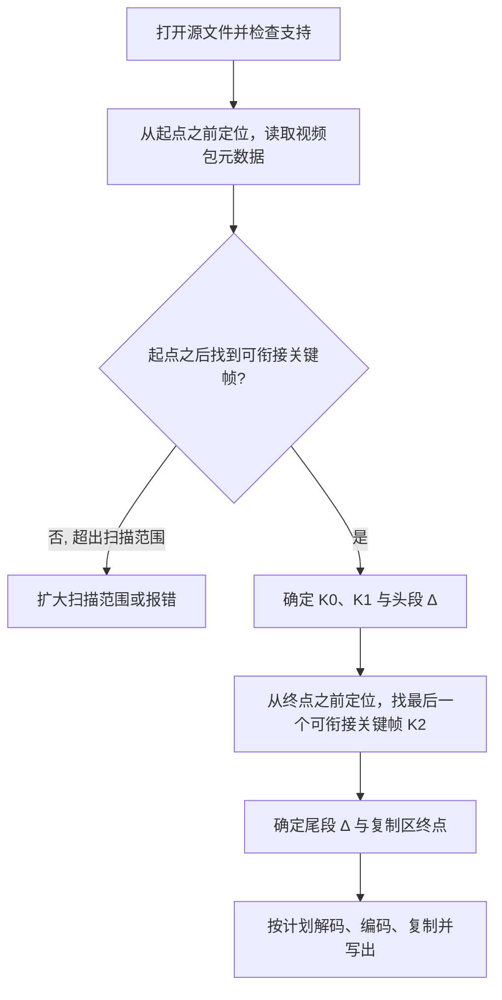

# 智能剪辑实现说明

本文记录智能剪辑（按帧剪切、只重新编码切点附近）的实现思路、各编码格式的衔接规则、输出方式及已知限制，供维护、评审和扩展时参考。界面中的名称为“智能剪辑”，代码、资源键与测试沿用 `FrameAccurate` 命名。

文中的数值（编码速度、画质）来自开发时在 4K 素材上的实测，用于说明取舍，不是性能保证。回归素材全部由脚本合成，不随仓库保存真实视频。

## 1. 功能与默认行为

- 默认是关键帧剪辑；工具栏右侧的“智能剪辑”开关切换模式，偏好会被记住，模式随工程保存，并在加入导出任务时固定。
- 智能剪辑模式下，片段起止点可以落在任意画面上。导出时只把起点、终点附近的少量画面重新编码，其余视频压缩数据原样复制；音频与字幕按数据包复制，不重新编码。
- 起点或终点恰好落在可衔接的关键帧上时，那一侧不重新编码；整个范围都可安全复制时完全不重新编码。
- 当前素材不支持时，开关禁用，悬停显示原因（见第 12 节）。偏好为开启时，按钮旁会显示警告图标，说明本素材改用关键帧剪辑，偏好本身不被改动。
- 切换模式不会悄悄移动已有片段的起止点。已有片段的边界不在关键帧上时，从智能剪辑切回关键帧剪辑会被拦截，并列出这些片段。

## 2. 基本思路

一个片段被分成三部分：

```text
源视频  ... K0 ........ S ...... K1 ======================== K2 ...... E ........
                         |        |                          |        |
输出                     [ 头段重编码 ][        复制区         ][ 尾段重编码 ]
```

- `S`、`E`：用户选择的起点与终点画面。
- `K0`：`S` 之前最近的关键帧，头段从这里开始解码；`K0` 到 `S` 之间的画面只用于把解码器“预热”到正确状态，不输出。
- `K1`：`S` 之后第一个**可衔接**的关键帧。从 `K1` 起的压缩数据原样复制。
- `K2`：`E` 之前最后一个可衔接的关键帧。尾段从 `K2` 解码，重新编码到 `E`。

衔接的关键是：复制区的画面不能参考任何被替换（重新编码）的画面，重编码段也不能依赖复制区。因此复制区只能从“干净的随机访问点”开始，即解码这一点及之后的画面不需要它之前的任何画面。哪些画面算干净的随机访问点，因编码格式而异，见第 5 节。

为什么不整段重编码：画质与速度都不可接受，而且大多数片段的复制区占 95% 以上。为什么不在任意 I 帧处衔接：开放 GOP 的 I 帧之后，可能有参考上一个 GOP 的画面，复制过去就会花屏。

## 3. 职责划分

| 部分 | 位置 | 职责 |
| --- | --- | --- |
| 支持判断 | `FrameAccurateExportService.CheckSupport`、`VideoInstance` | 按编码格式、档次、像素格式、隔行、杜比视界、容器、编码器是否可用判断能否使用，给出原因 |
| 规划 | `FrameAccurateExportService.Plan` | 扫描切点附近的视频包，确定解码起点、复制区起止、头尾段的 DTS 偏移 |
| 衔接点分类 | `SpliceContext.Classify` | 按编码格式判断关键帧能否作为复制起点，H.264 普通 I 帧需要验证 |
| 重新编码 | `FrameAccurateVideoEncoder` | 按源参数打开编码器，设定画质与码率上限，写入 HDR/杜比元数据 |
| 码流改写 | `H264Splice`、`VideoBitstream`、`Av1Bitstream`、`Vp9Bitstream` | 切片头改写、参数集处理、关键帧识别 |
| 写出 | `SpliceWriter` | 时间戳映射、拼接处 DTS 单调、参数集与样本描述切换 |
| TS 输出 | `FrameAccurateTsOutput` | TS→TS 按源传输包写出，保留原片的传输层异常 |
| 进度展示 | `OutputWindowViewModel.FrameAccurate`、`FrameAccuratePlanBar` | 计划条、阶段、重新编码/复制统计 |

导出直接调用 FFmpeg 运行库（解复用、解码、编码、复用），不拼接或执行外部命令行。命令行 ffmpeg 只用于生成回归素材和独立验证。

## 4. 规划



- **只读元数据**：规划阶段只读包的时间戳、大小与标志，必要时解析码流头部（NAL 类型、切片头、帧头），不解码画面。H.264 普通 I 帧的验证例外，需要解码，见 5.1。
- **扫描范围**：从目标之前定位，读到目标之后出现已确认的衔接点、文件结束，或超过重新编码上限为止。落入时间戳跳变时，定位余量会继续加倍。
- **重新编码上限**：每段重新编码最多 60 秒（`MaxReencodeSeconds`）。超过时拒绝导出，不静默扩大为整段重编码。没有任何可衔接关键帧、而范围内又有关键帧（例如全是开放 GOP）时同样拒绝。
- **按画面计算时长**：重新编码与扫描的长度按“画面数 × 帧时长”（包时长之和）计算，不按时间戳之差。接收中断会造成一分多钟的时间戳跳变，按时间戳计算会把紧邻中断的切点误判为“重新编码过长”。
- **终点前缀**：如果终点所在 GOP 中需要的画面恰好是解码顺序的前缀（例如只取到某个关键帧，或整个 GOP），直接复制，不重新编码尾段。
- **缺少 DTS**：Matroska 不存 DTS，定位后开头若干包没有 DTS。规划时按后续已知 DTS 减去包时长回推，复制时按上一包顺推。
- **码率参考**：每次扫描窗口（至少 0.5 秒）统计视频字节数与时长，取最大值作为“切点附近原码率”。全部编码会话共用这一个值，保证同一次导出中重编码的参数集一致。

## 5. 各编码格式的衔接点

容器的关键帧标志（`AV_PKT_FLAG_KEY`）只用来缩小范围，最终都要读码流本身确认。

### 5.1 H.264

**IDR**：IDR 清空参考帧，是天然的衔接点。IDR 之后、显示在它之前的前导画面只参考 IDR 及之后的画面，随 IDR 一起复制或一起解码。衔接条件是：上一个 IDR 之后、本 IDR 之前的包，显示时间都早于本 GOP 的最早显示时间（闭合 GOP）。

**普通 I 帧**：广播素材常常全片没有 IDR，只有普通 I 帧（开放 GOP，前导 B 帧参考上一个 GOP）。只认 IDR 会导致整片无法使用智能剪辑，所以普通 I 帧作为“待验证的随机访问点”：

1. 结构检查：I 帧全部是 I 切片、作为参考；GOP 内没有长期参考操作；衔接点附近的场画面满足后文的限制。
2. 复制时改写为 IDR（`H264Splice.CopyRewriter`）：
   - `nal_unit_type` 改为 5，插入 `idr_pic_id`（在 1、2 之间交替，避开 x264 首个 IDR 的 0），标记改为 IDR 形式；
   - 复制区此后每个切片的 `frame_num` 减去该 I 帧的值，取模后位宽不变；
   - 删除指向 I 帧之前画面的 MMCO；遇到码流自己的 IDR 后停止改写。

   必须改写的原因：参数集只能在 IDR 处切换，而重编码段使用自己的参数集。
3. 前导画面不复制，随头段一起重新编码。前导画面中可以有作参考的 B 帧（B 帧金字塔），条件是它们紧跟 I 帧、`frame_num` 连续，且所带的 MMCO 只取消新码流中本就不存在的画面。场编码时作参考的前导 B 场对两场共用一个 `frame_num`，第二场紧跟第一场，丢弃后只占一个编号。丢弃它们之后，后续画面的 `frame_num` 依次前移。参考帧表同时记录原编号与新编号：参考列表修改与 MMCO 按原编号找目标，再以新编号写回。
4. **验证**：按复制时的实际方式生成码流（I 改 IDR、丢弃前导并重新编号、首包带参数集），用一个新的解码器解码，再与“从上一关键帧连续解码”的结果逐帧比较画面哈希，完全一致才可用。验证用的解码器沿用源流的重排序深度。结果按 PTS 缓存，多个片段共用。

   验证解码的是**实际要写出的码流**，而不只是“从 I 帧单独解码”：前导参考画面被丢弃并重新编号后，只有这样才能确认改写本身是正确的。改写器报“不支持”时，该 I 帧不可用；读取或定位错误照常报出，不会被当作“不能衔接”吞掉。

**场编码（PAFF）**：一个画面的两个场是两个包。规划按画面计算边界与时长，第二场记为 `SecondField`；参考帧模型按帧记录两个场的参考状态，MMCO 按帧/场的 picNum 规则判断目标是否存在。衔接后头几个画面的参考列表如果依赖 I 帧之前的画面，P 切片按默认列表规则构造完整列表，以显式修改写出，并用现有画面补齐缺项。列表长度不变，CABAC 解析不受影响；验证已确认这些项没有被使用。

**切片数据不变**：只改切片头。CABAC 由对齐位吸收切片头长度的变化；CAVLC 按位平移。输出重新加防竞争字节。

**逐行刷新**：只有 P/B 条带的恢复点（intra refresh）没有完整关键帧，复制区的 P 帧会参考已被重新编码的画面，无法无缝衔接，因此标为不支持（`GradualRefresh`）。MPEG-2 的同类码流全程没有 I 帧，只在部分 P 帧前重复序列头；预览把这些 P 帧当作恢复点，同样不支持智能剪辑。

### 5.2 HEVC

- 衔接点为 IDR（`IDR_W_RADL`、`IDR_N_LP`）。RADL 前导画面只参考本 IDR，随 IDR 处理。广播 4K 素材每个 IDR 都带 RADL，只接受不带前导画面的 IDR 会全部拒绝。
- **CRA 与 BLA**：4K 广播素材常常除开头外没有 IDR，每个关键帧都是 CRA，其后跟着参考上一 GOP 的 RASL 前导画面。按规范，CRA 之后的普通画面不参考 CRA 之前的画面，所以 CRA 可以衔接，而且不需要像 H.264 普通 I 帧那样逐帧验证。处理方式与 MPEG-2 开放 GOP 相同：复制起点的 RASL 不复制，随片头重新编码；尾段的 RASL 从上一个 CRA 起预热解码后重新编码。
- 复制起点的 CRA 改写为 BLA_W_LP：只改 NAL 头中的类型，两者切片头语法相同。CRA 若接在其他画面之后，会沿用之前的画面计算 POC；改为 BLA 后，解码器在此像在 IDR 处一样开始新的编码视频序列。FFmpeg 不改写也能解码，但改写后的码流才符合规范。TS 输出按“改写过的 PES”写回原包位置。
- 帧内（Intra）档次的素材每帧都是 IDR，直接复制，无需重新编码。

### 5.3 MPEG-2

- 衔接点为帧图像的 I 帧。广播 MPEG-2 普遍是开放 GOP（`closed_gop = 0`，I 之后有参考上一 GOP 的前导 B 帧），只接受闭合 GOP 会导致整片无法衔接。
- 开放 GOP 的复制起点：前导 B 帧不复制，由头段解码器解码 I 与前导 B 后重新编码；复制的 I 所在 GOP 头改为 `closed_gop = 1`。前导 B 已被移除，这个标志在新码流中成立，而且只改头部 1 位，不改画面数据。
- 尾段的 I 帧前导 B 需要上一个 GOP：复制过程中从上一个 I 起同时送入解码器预热，不输出这些画面。
- 解码起点必须显示不晚于起点：开放 GOP 的 I 之前的前导画面无法解码。

### 5.4 AV1

- 衔接点为显示的关键帧（`KEY_FRAME` 且 `show_frame = 1`）：它重置全部参考帧。时间单元没有重排序，也没有前导画面。
- 复制区整段原样写出，包括隐藏帧与 `show_existing_frame`。

### 5.5 VP9

- 样本（超帧时为其中第一帧）是关键帧即可，**不要求显示**。在线视频站的素材中常见“隐藏关键帧 + 只参考它的显示帧”组成的超帧。关键帧刷新全部 8 个参考帧槽，从这种样本开始解码同样独立；只认显示的关键帧，会少掉这些衔接点（实测一份素材中 381 个关键帧里有 23 个是这种结构）。
- 没有重排序，没有前导画面。复制区样本，包括带隐藏替代参考帧的超帧，原样写出。

## 6. 重新编码

### 6.1 结构与时间戳

- 重编码段不使用 B 帧，只在开头有一个关键帧，不插入后续关键帧。重编码段很短，用较高的画质参数弥补没有 B 帧的效率损失。
- **DTS = PTS − Δ**：头段 Δ 取复制区首个显示时间与复制起点关键帧 DTS 之差，尾段 Δ 取尾段首个显示时间与尾段关键帧 DTS 之差。这样头段末尾的 DTS 小于复制区首个 DTS，复制区末尾的 DTS 小于尾段首个 DTS，拼接处 DTS 单调。
- **重排序缓冲**：解码输出与编码之间有一个最多 4 帧的 PTS 重排序缓冲（`ReorderedFrames`）。正常码流的解码输出本就按显示顺序排列；但接收中断后参考关系与 POC 不再连续，解码器可能把中断前最后的画面晚于中断后的画面输出。重编码按显示时间排列，与播放器按时间戳显示的画面一致；更晚到达的画面按时间戳错误报出，不静默丢弃。
- **重排序深度**：x264 生成的 SPS 被改写，VUI 码流限制中的 `max_num_reorder_frames` 设为源流的重排序延迟。否则播放器从没有 B 帧的重编码段进入复制区时，会按 0 帧延迟输出，复制区 I 帧后的第一个 B 帧会丢失。声明的深度大于实际只会增加输出延迟，码流仍然合规。
- **隔行**：以首个解码画面的标志判定隔行与场序（流参数可能不准）；H.264 用 MBAFF 并保持场序，同一会话中途改变场序时报错。
- 解码帧上的原始画面类型与关键帧标志会被清除，否则编码器会照搬原 GOP 结构。

### 6.2 编码器与参数

| 源格式 | 编码器 | 主要参数 | 说明 |
| --- | --- | --- | --- |
| H.264 | libx264 | slow、CRF 10，档次与像素格式沿用源（含 High 4:2:2 / 10 位） | 使用与源不同的 SPS/PPS 编号 |
| HEVC | libx265 | medium、CRF 14、关闭 SAO；4:2:2 用 Main 4:2:2 10 档次 | 4K 用 slow 太慢 |
| MPEG-2 | mpeg2video | qscale 3、非线性量化、RD 宏块决策、trellis | 按原码率编码画质明显不足 |
| AV1 | libsvtav1（预设 8、CRF 16），没有时用 libaom-av1（实时模式、cpu-used 7、CRF 12） | 按分辨率分块、行级多线程 | libaom 质量模式 4K 约每秒 3 帧，实时模式约 20 帧 |
| VP9 | libvpx-vp9 | 实时模式、cpu-used 7、CRF 12、不用替代参考帧 | 4K 约每秒 50 帧，PSNR 约 52 dB；质量模式每秒只有几帧 |

码率上限：

- H.264/HEVC：`min(级别上限, max(4 × 切点附近原码率, 每像素 0.15 bit))`。像素率下限是为了避免静止画面统计出的低码率把开头的关键帧压得过狠。级别上限按档次的码率系数放大（High 4:2:2 为 4，High 10 为 3，HEVC 4:2:2 为 1667/1000）。
- MPEG-2：`min(档次/级别上限, max(2 × 切点附近原码率, 原声明上限))`，VBV 缓冲沿用原声明值。低码率片源（如 DVD）基本停在原声明上限，不会被抬高。

### 6.3 HDR 与杜比视界

- HDR10 静态元数据优先取流参数，缺失时取首个解码画面的 SEI，写入 x265 的 master-display / max-cll；HLG 只需要传输特性。打开编码器时也会传入首帧，因为 TS 中的这些元数据只在画面里。
- 杜比视界：只支持单层 Profile 5 与 8.1（HDR10 兼容基础层），不带增强层、元数据不压缩。x265 按每帧解码出的杜比元数据重新生成 RPU。打开编码器后，核对它推断出的配置与源一致；杜比素材的每一帧都必须带元数据，否则拒绝，不静默丢弃。
- 逐帧动态元数据（HDR10+）、软 3:2 下拉（重复场）在重新编码的画面上无法保留，出现时拒绝。

## 7. 复制区的码流处理

### 7.1 H.264 参数集

- 视频统一以 Annex B 交给复用器。MP4/MKV 输入的长度前缀在源包上原地改为起始码，需要插入数据时直接写入新包的缓冲区，不复制成托管数组。
- 附加数据同时包含原始与重编码参数集。MP4/MKV 由 FFmpeg 生成含多组参数集的 avcC，并把包转回长度前缀，NAL 内容不变。
- TS：重编码段首个 IDR 前插入重编码参数集；复制区每个缺少 SPS 的 IDR 前插入原始参数集。

### 7.2 HEVC 参数集

x265 固定使用 0 号参数集。改成其他编号会改变 `ue(v)` 的长度，需要完整解析并重排切片头，风险太高，所以采用“切换”而不是“并存”：

- **MP4（hvc1）**：在参数集切换处给包附带新的附加数据（`AV_PKT_DATA_NEW_EXTRADATA`）。FFmpeg 的 mp4 复用器会为轨道新建样本描述（stsd 多条目），切回时复用已有条目，并从样本中去掉 VPS/SPS/PPS。样本描述 1 是原始参数集，样本描述 2 是重编码参数集。
- **TS/MKV**：重编码段由 x265 带内输出参数集；复制区首包前重发原始参数集，新的编码视频序列可以重新定义 0 号参数集。
- MP4 标记：杜比视界配置的基础层兼容编号为 0（如 Profile 5）时写 dvh1，非 0（如 8.1）时写 hvc1，dvcC/dvvC 照常写入。关键帧剪辑、合并封装与智能剪辑共用同一个选择函数。

### 7.3 MPEG-2

保留原始序列头作为附加数据。重编码段的序列头参数与复制区不同，所以在切换处插入 `sequence_end_code` 开始新序列；复制起点缺少序列头时补上原始序列头（量化矩阵等）。

### 7.4 AV1 与 VP9

- AV1：重编码段的序列头由编码器写在其关键帧中（不设全局头），复制区沿用源关键帧中的序列头；源关键帧不带序列头时从 av1C 补上。输出保留源 av1C。
- VP9：关键帧自带画面尺寸、位深与色彩空间，不需要补任何头；样本原样写出，保留源 vpcC。
- 两者都只支持 MP4/MKV 输出（每个样本一个画面）。

## 8. 音频、字幕与其他轨道

- **音频**：按包复制，保留显示时间在 `[起点, 终点画面显示结束)` 内的包，不重新编码；起点误差小于一个音频帧。TS 定位时向前预留余量，因为音频可能先于视频写入文件，早于起点的包会被丢弃。
- **文字字幕**：裁剪到选择范围，规则与关键帧剪辑的封装导出相同。ASS 带时序特效且需要裁剪时拒绝，因为裁剪会改变特效。
- **图形字幕与图文**（DVB 字幕等）：按包的时间复制，不裁剪。
- 视频完成后只为其他轨道再读取有限范围，稀疏字幕不会把读取拖到文件末尾。
- **PCM 声道布局**：MOV 的 lpcm 音频可能不带 chan 原子，解复用后只有声道数，没有布局；而 MP4 的 PCM 必须声明布局，否则写文件头时报“参数无效”。建流时按声道数补默认布局（双声道为立体声），关键帧剪辑与智能剪辑共用。
- **302M 采样率**：部分广播源的 SMPTE 302M 音轨（常见于承载杜比 E 的回传信号）AES3 头声明的长度与 PES 不符，解码器解析不了头，探测不到采样率，复用器写文件头时报“参数无效”。302M 固定为 48 kHz，建流时补上；TS 输出仍按源传输包写出该音轨，不受影响。
- MP4/MKV 输出只包含所选轨道；TS 输出见下一节。

## 9. TS 输出：按源传输包写出

### 9.1 为什么不用 FFmpeg 的 mpegts 复用器

经 mpegts 复用器重新打包，原片的传输层异常会全部消失：CC 重新编号，TEI 消失，不完整的 PES 被写成完整的短 PES，PCR 与节目表被重建，空包与未知 PID 丢失。TSCutter 再扫描输出时，就看不到原片的问题了。关键帧剪辑按字节复制，这些异常都在，两种模式的结果应该一致。此外，mpegts 复用器也不写杜比视界描述符。

### 9.2 做法（`FrameAccurateTsOutput`）

TS→TS 且输出包长与源一致、无需规范化时间戳时，以源文件的传输包为骨架逐包写出：

- 复制区视频、音频、字幕、节目表、空包、其他 PID 原样写出。
- 需要改写的 PES（I 帧改 IDR、切片头重新编号、补参数集、边界音频帧裁剪）写回原包位置：保留包头（TEI、CC 跳号）与适配字段（PCR），只换负载；多出的部分接新包，不足时用填充或删包补齐。
- 重编码画面按顺序占用被替换画面的视频包位置，一个画面占一个位置，放不下的部分在下一个视频 PES 之前补包。不能跨到更后面的位置：否则可能越过时间戳跳变，实测在信号中断处，中断后的音频会排到中断前的画面之前。
- CC 按 PID 用偏移接续：新增、删除包不产生假的跳号，原有的跳号与重复包保持不变。某 PID 首次写出的是新增包时，下一个源包的 CC 直接接在它后面。
- 只有适配字段的包（PCR、填充，广播视频 PID 上很常见）不放负载，原样保留，否则会出现同 CC 不同内容。
- 重复包按整包字节相同判断，带 TEI 的包不算重复包。
- 保留区间内解复用器没有输出的损坏 PES（信号中断处常见）：音频、字幕在前后都有保留 PES 时原样保留；视频只保留复制区内完全未被解复用的 PES。这样损坏数据及其中的异常与关键帧剪辑一样留在输出中。
- 第一个片段保持原时间戳（与关键帧剪辑一致），开头补最近一份 PAT/PMT/SDT 原包。
- 每个 PES 写出后立即释放其数据，内存只与管线和写出之间的滞后有关，不随片段长度增长。

重编码部分的视频是新数据，原片在这些视频包上的异常不会再出现；其余 PID 与复制部分的视频异常都会保留。

### 9.3 多节目与杜比视界

- 多节目 TS 只输出预览视频所在的节目：写出的包再经过 `TsServiceFilterService` 的节目过滤（与关键帧剪辑按节目导出相同），重建 PAT/PMT/SDT，EIT 按 service 过滤，去掉其他节目的 PID。重建的节目表本身的异常不保留。
- 源 PMT 中的杜比视界描述符原样保留；多节目重建 PMT 时随基本流描述符一起保留。万一没有按传输包写出（例如 TS 与 M2TS 互转），导出前拒绝。

### 9.4 异常解码时间戳的兼容路径

部分录制的 DTS 持续晚于 PTS，播放器能够容忍，但直接用于拼接可能没有足够的解码预滚空间。
保存前只读取切点窗口内的视频包元数据，复用已覆盖相邻切点的窗口，不提前解码验证衔接点或创建编码器，也不扫描整份文件。完整切点规划仍在正式导出时执行。检测到超过 1ms 的偏差时，在选择输出文件之前弹窗说明
会规范化时间戳、重新封装 TS。用户确认后再选择位置并导出；取消不打开保存窗口，也不改动已有输出文件。检查期间在主窗口状态栏提示并提供取消入口，不提前弹出导出进度窗口。

- 全部片段共用窗口中测得的视频 DTS 校正量，并按校正后的解码时间重新规划切点。
- 只调整视频 DTS，不改变所选画面及音频、字幕与画面的相对时间关系；切点附近仍重新编码，中间继续复制。
- 由复用器重建 PCR 与 PES，必要时补写原来省略的 DTS。此路径不保留原始 TS 包结构、传输错误和未知 PID；不能按传输包导出的杜比视界 TS 仍拒绝。
- 规范化直接在导出管线内完成，不生成完整的修复中间文件。导出期检测分析最终写出的字节。
- 批量任务在开始前汇总需规范化的源文件，对同一源文件只确认一次。普通素材与关键帧字节截取沿用原流程。
- 校正量超过 1 秒、写出时仍有 DTS 倒退或 DTS 晚于 PTS 时拒绝导出，不动态增大偏移或放宽检查。

## 10. 多片段合并

- 多个片段合并为一个文件时，只支持同一源文件、同一组轨道。全部片段共用一个写出器与一个码率参考值。
- 后续片段的 PTS/DTS（TS 还有 PCR）整体平移，接在上一片段之后。
- TS 中每个 PCR PID 在后续片段的首个 PCR 倒退或间隔明显变化时设置 `discontinuity_indicator`（与关键帧合并一致），显示时间戳仍然连续。

## 11. 异常与信号中断

- 时间线保持原样：中断造成的时间戳跳变保留在输出中，复制区中的损坏包按原样复制（与关键帧剪辑一致）。
- 重编码段中的损坏画面按解码器隐藏（错误隐藏）后的结果编码。
- 跨中断、在中断前结束、从中断后第一个可解码画面开始，都可以导出。输出画面与源文件连续解码得到的画面一一对应：按显示时间排列后帧号相同，时间间隔相同。

## 12. 支持范围与不支持的原因

| 项目 | 支持 | 不支持（界面原因） |
| --- | --- | --- |
| 输入 | TS、M2TS、MP4、MKV 等可剪辑的文件；DVD、蓝光标题（镜像或目录） | |
| H.264 | Baseline、Main、High、High 4:2:2（4:2:0/4:2:2，8/10 位），逐行与隔行 | Intra 档次、4:4:4；逐行刷新 |
| HEVC | Main、Main 10、RExt 中的 4:2:2 8/10 位，逐行；IDR 或 CRA（开放 GOP）衔接 | 隔行；4:4:4、12 位等其余 RExt |
| MPEG-2 | Main、Simple（4:2:0），含开放 GOP 与隔行 | 4:2:2 档次；逐行刷新 |
| AV1 | Main（8/10 位 4:2:0），逐行，MP4/MKV | 其他档次；TS 输出 |
| VP9 | Profile 0（8 位）、Profile 2（10 位），4:2:0 逐行，MP4/MKV | Profile 1/3、12 位；TS 输出 |
| 杜比视界 | 单层 Profile 5、8.1 | 双层、8.2/8.4、压缩元数据；TS 与 M2TS 互转 |
| 其他 | | 多个视频轨道；HDR10+；软下拉；运行库缺少对应编码器或不支持该像素格式 |

编码器是否可用，按运行库中编码器实际支持的像素格式判断（`avcodec_get_supported_config`），例如 x264 是否带 10 位支持。

导出时才能发现的问题（找不到衔接点、重新编码超过上限、参考结构不支持、时间戳不单调等）在写出前或写出中报错，临时输出会被删除，不会留下不完整的目标文件。

### 光盘标题

- 光盘标题经读取层打开（蓝光按播放列表、DVD 经 dvdvideo），输出由复用器写出：DVD 为 VOB、MKV 或 MP4，蓝光为 M2TS、MKV 或 MP4，没有可逐包复制的源文件，不使用第 9 节的按传输包写出。来源是否变化按光盘目录中的各文件或镜像文件判断。
- 蓝光读取层已把播放列表各片段的时间戳统一，切点直接按 PTS 规划。
- DVD 的 dvdvideo 按标题时间定位只到 VOBU，并以目标时间重建时间戳，同一画面每次定位后的 PTS 不同；个别光盘的时间定位偏差可达数十秒。因此：
  - 读取层登记读到的视频关键帧（压缩包签名与 PTS），每次定位后先读两个关键帧（都未登记时最多八个），按最近登记的一个校正本次读取的时间戳。预览的逐帧步进由此前后一致。同一标题的预览读取（主预览、导航条、播放、波形）共用一份登记，同一画面在各处的时间戳相同，点击导航条上的任意一帧都能精确定位；导出各用一份，不受预览中同时进行的读取影响。
  - 预览中标记的画面记为附近关键帧的签名加相对该关键帧的偏移，不依赖当时的 PTS。
  - 关键帧剪辑一次读取查找起止签名；读到标题末尾后，后续定位或写出需要时重新打开读取器，避免 dvdnav 的停止状态影响导出。
  - 导出时所有定位都回到同一锚点（最早起点之前 180 秒），每次读取的内容与时间戳完全相同；先从锚点顺序读到各起止画面的关键帧，把它们换算到这条时间轴，再按普通流程规划与导出。锚点之后读不到某个画面时从标题开头重读一次，仍找不到则报“找不到画面”。
- dvdvideo 不给出 MPEG-2 的档次与级别；DVD-Video 只允许主档次主级别（MP@ML），读取层按此补上，用于编码检查和重编码的码率与 VBV 上限。
- DVD 字幕每个包是完整的位图与显示时间，随 VOB、MKV 按包复制；起点之前开始显示的字幕不输出。
- 蓝光 PGS 字幕随 M2TS、MKV 输出。显示集合会复用之前的调色板、窗口和图形对象，每段开始前从起点回看 30 秒，重建起点时的显示状态，作为一个完整的显示集合写在片段起点；回看范围内没有完整状态（没有找到这段字幕的起点）时，视为起点处没有字幕，不补写，也不再扩大范围。片段内的显示集合原样复制，片段结束时（保留到文件末尾的除外）写入清屏，接缝两侧的字幕不会互相延续。

## 13. 进度展示

- 输出窗口在智能剪辑任务收到首个进度时显示计划条：按时长比例分段，重新编码为橙色、直接复制为绿色，已处理的部分为实色，当前位置画竖线，片段之间留间隙。
- 阶段依次为：定位 → 片头重新编码 → 复制 → 片尾重新编码 → 完成。多片段时带“片段 i/n”。
- 摘要显示重新编码与复制的时长，以及无需重新编码的比例：
  - 比例精确到 0.1%，向下取整，只要有重新编码就不会显示 100%；有复制但不足 0.1% 时显示“<0.1%”。
  - 时长不足 0.1 秒时保留两位小数，只重新编码 1 帧时不会显示成 0.0 秒。
- 百分比与剩余时间按输出时长估算。重新编码比复制慢，所以剩余时间在片头、片尾阶段偏乐观。
- 单节目 TS 的片段大小显示为源字节范围的预估值（“~xx MB”）；需要重新封装的来源显示“导出后确定”。

## 14. 测试与验证方法

回归素材由 `tools/generate-frame-accurate-test-samples.py` 生成，输出目录被 Git 忽略。关键手段：

- **画面内的帧序号**：每帧顶部 16 行用 16 个亮/暗块编码帧序号，重新编码后仍能可靠识别。解码输出即可核对首尾画面、帧数与顺序，不依赖时间戳。
- **复制区逐字节比较**：复制区的切片数据（AV1/VP9 为整个样本）必须与源完全一致；TS 输出还要检查同样的事件（TEI、重复包、CC 跳号与缺失包数、PTS/PCR 跳变量）是否原样出现。
- **严格解码**：输出以严格模式解码，必须无错误。另外用不沿用探测延迟的解码器（相当于播放器从文件开头打开）再解码一次，检查不丢帧。
- **素材覆盖**：
  - 闭合/开放 GOP、B 帧金字塔、CAVLC、MBAFF 与 PAFF 隔行；
  - HEVC RADL、HLG/HDR10、4:2:2；
  - 33 位 PTS 回绕；
  - 信号中断（删去部分 TS 包并推后时间戳）；
  - 注入 TEI、重复包、丢包与只有适配字段的包；
  - 双节目 TS；
  - AV1 与 VP9 的隐藏帧和超帧；
  - PCM 音频未声明声道布局的 MOV；
  - AES3 头长度与 PES 不符、探测不到采样率的 302M 音轨。
- **变异验证**：关键修正都确认过“去掉它测试就失败”。例如改走 FFmpeg 复用器、删包不调整 CC、按时间戳计算范围、去掉重排序缓冲、不改写 SPS 重排序深度、只认显示的 VP9 关键帧。
- **可选的真实素材检查**：通过环境变量指定本地素材（杜比视界、广播 TS 等），见 `src/TSCutter.GUI.Tests/README_CN.md`。

## 15. 已知限制

- 一条 HEVC 轨道中的多个样本描述已在 FFmpeg 系播放器上验证，Apple 与 Windows 系统播放器未验证。
- 隔行 H.264 源中零星的逐行帧，在重编码段会被标为隔行（场序不变）。
- 重编码段中，原片在被替换视频包上的传输层异常不再出现（那些包已被新数据取代）。
- MP4 输出的时间码轨由复用器按源时间码生成，起始时间码沿用源文件，不随剪切起点偏移。
- 单节目 TS 的大小预估取源字节范围；重编码段的码率与原片不同，实际大小会略有偏差。
- 逐行刷新的 H.264（只有 P/B 条带的恢复点）和 MPEG-2（没有 I 帧，序列头之后的 P 帧作为恢复点）暂不作衔接点，这类素材无法使用智能剪辑。
- 蓝光 PGS 字幕起点回看固定 30 秒：更早开始、仍在显示的字幕（或其图形对象在更早的显示集合中）不会补写，要到下一次完整显示时才出现。
- DVD 导出从锚点顺序读取，规划时每次定位都要从锚点重读，片段很长时准备阶段较慢。
