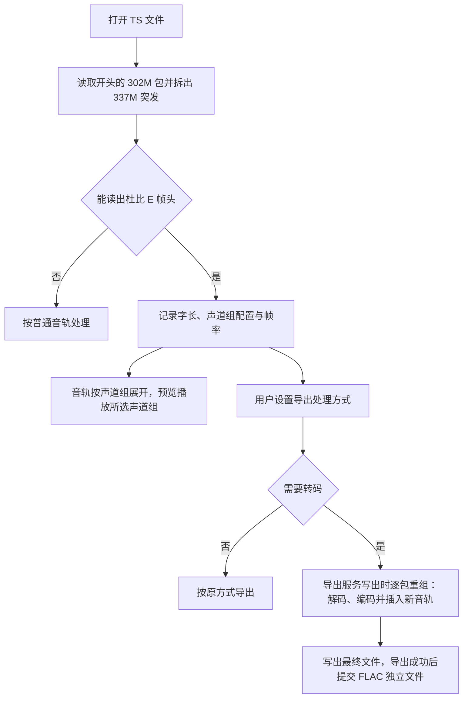

# 杜比 E 转码设计方案

## 1. 目标

杜比 E（Dolby E）是广播制作链路中使用的多声道音频编码，常以 SMPTE 302M 的 PCM 轨承载在 TS 中。
普通播放器不能解码杜比 E：有的把它当作无法识别的数据丢弃而没有声音，有的把它当作 PCM 直接播放成噪声。

本功能在剪辑与导出流程中处理杜比 E：

- 识别 302M 轨中的杜比 E，显示声道组配置，并在预览中播放指定声道组；
- 由用户为每条杜比 E 轨指定导出时的处理方式：原样保留，或转码为普通音轨；
- 转码时可按声道组分别输出，同一声道组可同时输出多种编码；
- 可以替换原杜比 E 轨，也可以同时保留；
- 重组 TS 时不掩盖源文件原有的传输错误。

## 2. 范围与非目标

### 2.1 当前范围

- 188 字节 TS 与 192 字节 M2TS；
- SMPTE 302M 承载的 SMPTE 337M 杜比 E 突发，字长 16、20、24 位，含扰码密钥的帧；
- 全部 24 种声道组配置；
- 输出编码：AC3、E-AC3、AAC、FLAC、PCM；
- 所有产生 TS 的导出：关键帧剪切、只导出当前节目、补节目表或音频延迟的逐包导出、合并、删除模式、智能剪辑；
- 预览播放与导航条波形按所选声道组解码。

### 2.2 非目标

- 不编码杜比 E，也不修改杜比 E 码流；
- 不处理 MP4、MKV 等其他容器中的杜比 E；
- 不改动视频、其他音轨、字幕与业务信息；
- 不重新复用为固定码率，不重新生成 PCR；
- 不修复源文件中损坏或缺失的杜比 E 帧。

## 3. 杜比 E 在 TS 中的承载

杜比 E 的承载分为三层：

1. TS 中的 302M 轨：stream_type 0x06，注册描述符为 `BSSD`。每个 PES 承载一段 AES3 样本，通常一个视频帧一个 PES；
2. AES3 样本中的 337M 突发：以 Pa/Pb 同步字开始，Pc 给出数据类型（28 表示杜比 E），Pd 给出负载长度；
3. 突发负载中的杜比 E 帧：帧头给出字长、是否扰码、声道组配置与帧率。

杜比 E 的 program 是一条杜比 E 音轨内打包的一组声道（例如 5.1 主混音、立体声），与 TS 的节目（频道）不同，本文与界面中称为“声道组”。转码后每个声道组成为一条独立音轨。

FFmpeg 的处理能力与限制：

- 302M 解码器默认丢弃非 PCM 数据，“解码”杜比 E 的选项没有实现；改为原样输出时可以得到 AES3 字；
- 302M 解码器只在同步字位深与容器一致时识别非 PCM。16 位杜比 E 装在 20 位 302M 中时会被当作 PCM 输出，播放成噪声；
- 337M 解复用器只读取原始 PCM 字节流，不能直接从 TS 读取；
- 杜比 E 解码器每帧输出 1792 个样本，采样率随帧率变化（25 fps 时为 44.8 kHz），需要重采样到 48 kHz；
- 杜比 E 解码器不导出声道组配置；多声道组时输出按杜比 E 声道号排列，声道布局标签不反映实际声道组。

因此拆帧、帧头解析和声道组拆分由软件完成，FFmpeg 只负责 302M 的样本解包和杜比 E 的音频解码。

## 4. 总体流程

## 5. 识别与声道组配置

打开文件时，只对可按字节剪辑的 TS 中的 302M 轨进行识别：另开一个输入，读取开头若干 302M 包，
拆出突发并解析帧头。读到两个有效帧头即确认为杜比 E；文件很短时读到一个也确认。识别不解码音频，
不扫描整个文件。

声道组配置决定声道组数量与各声道组的声道。声道按编号顺序分配给各声道组：

| 配置 | 声道组 | 声道数 | 配置 | 声道组 | 声道数 |
|---|---|---|---|---|---|
| 0 | 5.1 + 2 | 8 | 12 | 4 + 2 | 6 |
| 1 | 5.1 + 1 + 1 | 8 | 13 | 4 + 1 + 1 | 6 |
| 2 | 4 + 4 | 8 | 14 | 2 + 2 + 2 | 6 |
| 3 | 4 + 2 + 2 | 8 | 15 | 2 + 2 + 1 + 1 | 6 |
| 4 | 4 + 2 + 1 + 1 | 8 | 16 | 2 + 1 + 1 + 1 + 1 | 6 |
| 5 | 4 + 1 + 1 + 1 + 1 | 8 | 17 | 1 × 6 | 6 |
| 6 | 2 + 2 + 2 + 2 | 8 | 18 | 4 | 4 |
| 7 | 2 + 2 + 2 + 1 + 1 | 8 | 19 | 2 + 2 | 4 |
| 8 | 2 + 2 + 1 + 1 + 1 + 1 | 8 | 20 | 2 + 1 + 1 | 4 |
| 9 | 2 + 1 × 6 | 8 | 21 | 1 × 4 | 4 |
| 10 | 1 × 8 | 8 | 22 | 7.1 | 8 |
| 11 | 5.1 | 6 | 23 | 7.1（屏幕声道） | 8 |

各声道组的声道顺序：5.1 为 L R C LFE Ls Rs；4 声道为 L R C S；7.1 为 L R C LFE Ls Rs Lrs Rrs，
屏幕声道配置的后两路为 Lc Rc。只有一个声道组的 8 声道配置的解码输出已按 FFmpeg 的 7.1 顺序重排，拆分时换算回声道号。

片中声道组配置可能变化。识别只看开头，导出和播放时逐帧按实际配置处理。

## 6. 解码

1. 302M 解码器以原样输出方式解出 AES3 字，统一换为左对齐的 32 位样本；
2. 在每个 AES 声道对中查找 16、20、24 位的 Pa/Pb，同步字的位深与容器位深无关；
3. 按 Pd 收集负载，转换为杜比 E 解码器要求的大端字；突发可以跨越 PES；
4. 解析帧头，再交给杜比 E 解码器；
5. 按声道组配置从整帧中取出所需声道组，重排为标准声道顺序。

突发的时间戳为所在 PES 的 PTS 加上突发起点的样本偏移。302M 包之间时间不连续（定位、丢包）时，
丢弃跨包的残缺突发；突发未收完又出现同步字时，从新突发重新开始。

## 7. 预览播放

杜比 E 轨在音轨列表中按声道组展开，每个声道组一条。选中后，播放与导航条波形只解码该声道组，
多声道下混为立体声输出。没有该声道组的帧（配置变化后）不输出声音。

## 8. 输出设置

每条杜比 E 轨按 PID 记录一份设置：

- 处理方式：原样保留，或转码为普通音轨；
- 转码时是否同时保留原杜比 E 轨，默认不保留，转码结果替换原轨；
- 输出列表：每行指定声道组、编码、声道（原始、立体声下混、单声道下混）、码率与语言；同一声道组可以有多行。

切换到转码时，按声道组各生成一行 AC3 输出，声道保持原始布局，语言取源轨。码率默认值：

| 编码 | 单声道 | 立体声 | 4 声道 | 5.1 |
|---|---|---|---|---|
| AC3 | 96 kbps | 192 kbps | 384 kbps | 448 kbps |
| E-AC3 | 96 kbps | 192 kbps | 384 kbps | 448 kbps |
| AAC | 96 kbps | 192 kbps | 256 kbps | 384 kbps |

FLAC 与 PCM 为 24 位无损输出，没有码率选项。

新打开的文件默认原样保留，导出结果与不使用本功能时逐字节相同。

不同文件的杜比 E 处理方式通常不同，设置不写入程序配置，只随工程文件与导出队列保存。
修改后，与音频延迟一样，已导出的片段重新标记为待导出。

## 9. 编码与封装

| 编码 | TS 中的标识 | 最多声道 | 说明 |
|---|---|---|---|
| AC3 | DVB：0x06 + AC-3 描述符；ATSC：0x81 | 5.1 | 源节目表含 ATSC 音频类型时使用 ATSC 方式 |
| E-AC3 | DVB：0x06 + E-AC-3 描述符；ATSC：0x87 | 5.1 | 运行库的编码器最多支持 5.1 |
| AAC | 0x0F（ADTS） | 5.1 | ADTS 的 7.1 声道配置兼容性差 |
| PCM | 0x06 + `BSSD`（302M） | 8 | 运行库没有 302M 编码器，由软件按 24 位打包；单声道写成两路 |
| FLAC | — | 8 | TS 中没有标准标识，另存为独立文件 |

有损编码最多 5.1，7.1 声道组下混为 5.1。所有输出统一为 48 kHz。设置了语言时，新音轨带 ISO 639 语言描述符。

FLAC 写入 TS 后无法被播放器识别，导出时另存为与输出文件同名、带声道组序号的 `.flac` 文件。
独立文件没有时间戳，因此缺失的时段补静音，使文件与视频起点保持同步。

## 10. TS 重组

重组逐包处理导出结果。原则是只改动必须改动的包，其他包原样复制，保留 CC 跳号、TEI、重复包、
时间戳与 PCR 跳变等原有的传输状态。

### 10.1 PMT

只改写含杜比 E 轨的节目的 PMT：

- 替换原轨时，在原条目的位置写入新音轨的条目；保留原轨时，新条目接在原条目之后；
- 只换负载，保留各包包头（含 TEI 与 CC）与适配字段；
- 新的段变长时在后面补包，变短时去掉多余的包，该 PID 之后的 CC 按偏移接续，原有的跳号保持不变；
- CRC 错误、段不完整或与其他段共用包的 PMT 原样保留。

### 10.2 杜比 E 包

- 保留原轨时，杜比 E 包原样复制；
- 替换原轨时，新音轨的包依次占用原杜比 E 包的位置，多余的位置删去。原杜比 E 轨兼作 PCR PID 时，
  载有 PCR 的包改为只含适配字段的包，PCR 原样保留；
- 替换时第一路输出沿用原 PID（兼作 PCR PID 时除外），其余输出使用原 PID 之后未被占用的 PID。

### 10.3 新音轨的放置

每个编码帧打包为一个只带 PTS 的 PES，新 PID 的 CC 从 0 连续。新 PES 放在与其时间对应的杜比 E PES 之前，
使到达时机与原轨接近。源文件中杜比 E PES 有时只比 PTS 早十几毫秒到达，因此：

- 保留原轨时，提前一个杜比 E PES 插入；
- 替换原轨时，新包分散在原包位置上，后面的包到得较晚，提前两个杜比 E PES 放入。

### 10.4 时间与错误

新音轨的时间戳从杜比 E 帧的时间推算：一段连续的输入从首帧时间开始，按 48 kHz 样本计数递增。
损坏或缺失的杜比 E 帧使输入不连续时，编码器结束当前段并重新开始，新音轨中留下同样的间隙，不补静音。

## 11. 一遍写出与文件安全

重组在导出服务写出文件时一遍完成，不生成中间文件，也不重读输出：

- 各 TS 导出服务打开输出文件时经同一个入口。没有转码计划时得到普通文件流，参数与原来完全相同，导出结果逐字节不变；
  有计划时得到重组输出流，导出服务的写出代码不变；
- 写入的字节按包处理，杜比 E 包写入时即解码、编码；新音轨要比对应的杜比 E 帧提前放入，
  因此输出暂存到解码领先约十个杜比 E 帧后再写出，通常只有几百毫秒的数据；杜比 E 长时间中断时暂存量达到上限后不再等待；
- 导出检测由重组输出流接收最终写出的字节；
- 节目表中找不到杜比 E 轨时不做改动，原样写出；
- FLAC 独立文件先写为临时文件，导出成功后改为正式文件名；失败或取消时删除，转码出错时同时删除不完整的输出；
- 由封装器直接写文件、没有经过重组输出流的导出路径不支持转码，导出时明确报错，不会静默漏掉新音轨。

## 12. 已知限制

- 有损编码最多 5.1，7.1 声道组只能以 FLAC 或 PCM 保持 7.1；
- 声道组配置 0 与 11 以外的声道组拆分按配置表实现，缺少真实素材验证；
- 文件最开头的第一个编码帧前面没有更早的位置，可能略晚于其 PTS 到达；
- 杜比 E 解码后的音画同步以 PES 的 PTS 为准；源文件存在固定偏差时，可用音频延迟修正；
- 识别只读取文件开头，开头没有杜比 E 帧的文件不会识别。

## 13. 验证方案

### 13.1 识别与解码

- 生成 16、20、24 位的 337M 突发，验证拆帧、跨包续接与残缺突发后的重新同步；
- 生成带与不带扰码密钥的帧头，验证声道组配置与帧率解析；
- 校验 24 种配置的声道分配连续、覆盖全部声道；
- 用含 20 位杜比 E（配置 0，5.1 + 2）与 16 位杜比 E 装在 20 位 302M 中（配置 11，5.1）的素材，验证识别、
  逐帧时间戳递增与各声道组拆分。

### 13.2 重组

- 替换与保留两种方式下，AC3、E-AC3、AAC、PCM 新音轨都能被解复用器识别并解码，FLAC 独立文件可读；
- 与独立解码的杜比 E 做互相关，新音轨的时间偏差为 0 个样本；
- 统计各新 PES 的 PTS 相对 PCR 的提前量；
- 在导出结果中注入 TEI、CC 跳号与重复包，重组后杜比 E 与 PMT 以外的包逐字节不变；保留原轨时原杜比 E 包逐字节不变。

### 13.3 对现有导出的影响

- 用同一组参数分别以加入本功能前后的版本导出，覆盖关键帧剪切、文件开头片段、音频延迟、只导出当前节目、合并与智能剪辑；
- 素材包括普通 H.264、MPEG-2、HEVC、开放 GOP、双节目 TS，以及含杜比 E 但不启用转码的 TS；
- 输出应逐字节一致。智能剪辑的重编码画面由编码器多线程生成，同一版本多次运行也可能不同，需与同一版本的多次结果对照。

### 13.4 界面

- 设置窗口在三种界面语言下正常显示，默认值与提示随编码和声道组变化；
- 设置随工程文件与导出队列保存和恢复。
